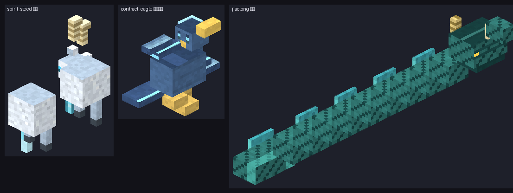

# 鸿蒙修仙 · Hongmeng Cultivation

以小说《谁把我仙侠游戏退出键扣了？》（作者：沐春，番茄小说）为蓝本的 **Minecraft Forge 1.20.1** 修仙模组。

**主角就是你自己。** 落地即被塞进「鸿蒙修仙传」，没有退出键，挨打会疼，死了要算业力。

---

## 一、当前状态

| 项目 | 状态 |
|---|---|
| Forge 版本 | 1.20.1 - 47.4.0 |
| Mod ID | `hongmeng` |
| 版本 | 0.1.0 |
| Java | 17 |
| 编译 | ✅ 55 个类全部通过 |
| 产物 | `build/libs/hongmeng-0.1.0.jar`（约 522 KB） |
| 美术 | 程序生成的占位素材（后期替换为你自己的图） |
| 音效 | 程序生成的 OGG（已转码，MC 可加载） |

### 已经过真机实测的部分

不是"能编译"，是**真的在游戏里跑过**：

| 验证项 | 方法 | 结果 |
|---|---|---|
| mod 被 Forge 加载 | `runClient` 启动 | ✅ 日志出现「鸿蒙修仙已载入：鸿蒙修仙传，退出键已扣。」 |
| 客户端资源 | 客户端资源重载 | ✅ 音效引擎、贴图图集正常创建 |
| 专用服务端 | `runServer` 启动 | ✅ `Done (12.337s)`，世界正常生成 |
| 27 个物品注册 | 命令 `give` 逐个提交 | ✅ 无 "Unknown item" |
| 4 个方块注册 | 命令 `setblock` 逐个放置 | ✅ 无 "Unknown block" |
| 自定义状态效果 | `effect give ... hongmeng:karma_bound` | ✅ 提示 `Applied effect effect.hongmeng.karma_bound to Pig` |
| `/hongmeng` 与 `/sect` 命令 | RCON 执行 | ✅ 根命令、子命令、中文输出全部正常 |
| **副本维度** | `execute in hongmeng:epoch_realm run setblock ...` | ✅ 维度真实加载并成功放置方块 |
| **门派执事实体** | `summon hongmeng:guilty_sect_disciple` | ✅ `Summoned new Sect Enforcer`（注册名 + 中文名都命中） |
| 服务端配置文件 | 首次启动 | ✅ 生成 `world/serverconfig/hongmeng-server.toml` |
| 服务端日志健康度 | 全量扫描 | ✅ 零异常栈、零未注册内容、零数据包错误 |
| **核心数值逻辑** | 离线断言（236 项） | ✅ **全部通过**，报告见 `VERIFY-REPORT.txt` |
| **境界标准值表** | 离线断言逐档核对 | ✅ 前 5 境与实测锚点一字不差（8/40/136/424/1288） |
| **装备体系** | 离线断言 + 资源完整性扫描 | ✅ 10 把剑 + 50 件法宝，模型与语言键 60/60 齐全 |
| **开局难度系统** | 离线断言 + 每档 40 万次抽样 | ✅ 五档难度分布精确符合需求，保底与怪物倍率逐条核对 |
| **境界实力数值** | 离线断言逐档核对 | ✅ 筑基 5 心 → 金丹 10 心 → 元婴 20 心 → … → 鸿蒙 240000 心 |
| **七档灵根品质** | 离线断言 + 40 万次抽样 | ✅ 名称与百分比完全符合需求（10/30/50/70/100/200/500%） |
| **道宫系统** | 离线断言 + 540 次凝聚模拟 | ✅ 五档加成精确、100/500 保底生效、破碎退能量保进度 |
| **任务系统** | 离线断言 | ✅ 16 条任务、3 章节、前置链、计数器、存档往返 |
| **境界挖掘等级表** | 游戏内 `/hongmeng tiers` | ✅ 十境映射逐条核对，道印为自定义金制（等级 3、速度 12） |
| **神霄剑宗山门结构** | 独立 NBT 解析校验 | ✅ 766 方块、10 种 palette、27 条断言全过 |
| `realm_mining` 配置段 | 服务端首次启动 | ✅ 生成 `realmMining` / `spawnerDropsAtNetherite` / `omniMiningTicks` |

### 离线逻辑验证覆盖的内容

`src/verify/java/.../LogicVerifier.java` 是一套不依赖游戏实例的断言测试，
用 `tools/run_verify.ps1` 一键跑（**普通沙箱权限即可**）：

- 境界阶梯：28 层总数、练气初期→鸿蒙、单调不降、progress/need 关系、满级判定
- 业力数学：基线失败率、每层压低 10% 成功率、下限钳制、9 层可试/10 层必败、
  金苹果全清、劫掠 -1 层、魔渊上限修正
- 灵根抽取：40 万次抽样验证七档品质概率与权重吻合、每档都有灵根可抽、
  仙品池含主角同款、仙剑灵根（冰异化）整体概率落在 0.4%~2%
- 保底重抽：2 万次验证永不低于玄品
- 门派：三派身份阶梯单调性、6 级身份边界、修为/攻击/突破/业力四类加成、
  `byId` 对 id/枚举名/中文名的容错
- **境界挖掘**：十境→挖掘等级的完整映射（含"道印不得低于化神"的倒退检查）、
  鸿蒙独占"可破坏一切"、面板文案、各档位能挖动哪些矿物
- **境界实力数值**：十档倍率、心数/攻击值逐档核对、能力解锁节点
  （速度 I / 飞行 / 速度 II / 本命领域）、攻击与生命严格同倍率
- **灵根品质**：七档名称与百分比精确匹配、各档都有可抽灵根、元素覆盖 8 种、
  旧存档 key 兼容映射、仙剑灵根概率
- **开局难度**：五档的灵根分布（每档 40 万次抽样）、伪灵根概率随难度递减、
  混沌/鸿蒙灵根只在高难度出现、道宫保底与上限、怪物倍率递增、
  境界系数递增、`byId` 对枚举名/中文名的容错
- 存档往返：14 个字段的 NBT 存取一致性（含难度与速度开关）

> 未能在自动化环境里验证的：需要真实玩家登录才能触发的玩法（觉醒抽灵根、
> 打坐涨修为、杀怪加修为、业力结算、突破判定、进入秘境打三波、
> **空手挖矿的实际掉落与鸿蒙掰基岩**）。这些逻辑已编译进 jar 并通过离线断言，
> 但请你在单机里实际跑一遍确认手感。
> 需要说明的是：**无玩家在线时实体区块不做运算**（原版僵尸同样被立即回收），
> 所以自动化环境无法验证实体存活与战斗；同理，采掘事件必须由真实玩家触发。


---

## 二、玩法内容

### 1. 灵根觉醒（七档品质 × 八种元素）

首次进入世界约 3 秒后自动觉醒，**按权重随机抽**，忠于原文「赌初始号」的手感。

灵根由**两个维度**组成：**品质**决定实力加成，**元素**决定对应元素功法的加成。

#### 七档品质（从最弱到最强）

| 品质 | 生命加成 | 攻击加成 | 抽取权重 |
|---|---|---|---|
| 伪灵根 | +10% | +10% | 45% |
| 凡品灵根 | +30% | +30% | 25% |
| 地灵根 | +50% | +50% | 15% |
| 天灵根 | +70% | +70% | 8% |
| 先天灵根 | +100% | +100% | 5% |
| 混沌灵根 | +200% | +200% | 1.8% |
| 鸿蒙灵根 | +500% | +500% | 0.2% |

> **品质加成独立于境界**：境界突破只在境界自身的基础上翻倍，
> 品质加成作用在最终数值上，不会被境界翻倍放大。

#### 八种元素

- **五行**：金、木、水、火、土
- **变异**：冰、雷、风

元素决定"对应元素的功法有加成"——道印凝聚出的本命领域会按元素给功法加成。

#### 灵根池（18 条，每档都有可抽的）

| 品质 | 条数 | 例子 |
|---|---|---|
| 伪灵根 | 1 | 伪灵根 |
| 凡品灵根 | 2 | 凡品土灵根、凡品木灵根 |
| 地灵根 | 5 | 地品金/水/火/风/雷灵根 |
| 天灵根 | 3 | 天品火/冰/雷灵根 |
| 先天灵根 | 3 | **仙剑灵根**（冰·变异）、先天金灵根、先天风灵根 |
| 混沌灵根 | 2 | 混沌冰灵根、混沌火灵根 |
| 鸿蒙灵根 | 2 | 鸿蒙雷灵根、鸿蒙风灵根 |

**主角同款**——`仙剑灵根`（品质：先天灵根，元素：冰·变异，隐藏状态）躺在先天池里，
抽中概率约 **1.7%**。抽到时会额外弹出原文那句「这玩意儿，论坛上有人出价上亿收。」

**重抽途径（保底地灵根以上，不会洗废）：**
- 任务链第 4 步给一座「测灵台」，站上去重测（每 60 秒一次）
- 洗灵丹（创造模式物品栏可取）
- `/hongmeng reroll`（默认开启，正式玩建议在配置里关掉）

### 2. 修为与境界（打坐只是其中一条路）

境界阶梯共 **10 大境 / 28 层**：

```
练气 → 筑基 → 金丹 → 元婴 → 化神 → 道印 → 飞升 → 仙人 → 帝境 → 鸿蒙
```

前 9 境各分「初期/中期/后期」，鸿蒙单独一层。境界是**累计修为的纯函数**，
不会出现「卡在某一层」的诡异状态。

#### 境界带来的实质数值（生命 / 攻击）

| 境界 | 相对筑基 | 生命加成 | 攻击加成 | 额外解锁 |
|---|---|---|---|---|
| 练气 | ×0.1 | +0.5 颗心 | +0.3 | — |
| **筑基** | **×1** | **+5 颗心** | **+3** | 基准 |
| 金丹 | ×2 | +10 颗心 | +6 | 空手挖掘·石制 |
| 元婴 | ×4 | +20 颗心 | +12 | — |
| 化神 | ×8 | +40 颗心 | +24 | **常驻速度 I**、空手挖掘·铁制 |
| 道印 | ×16 | +80 颗心 | +48 | **本命领域**、空手挖掘·金制 |
| 飞升 | ×48 | +240 颗心 | +144 | **飞行**、空手挖掘·钻石 |
| 仙人 | ×480 | +2400 颗心 | +1440 | 空手挖掘·下界合金、刷怪笼掉落 |
| 帝境 | ×4800 | +24000 颗心 | +14400 | **可切换的常驻速度 II** |
| 鸿蒙 | ×48000 | +240000 颗心 | +144000 | **可破坏一切方块** |

**增长规则**（完全按需求实现）：
- 筑基 = +5 颗心 / +3 攻击
- 金丹起每境 **翻倍**：金丹 10 心 → 元婴 20 心 → 化神 40 心 → 道印 80 心
- 飞升 **×3**：240 心
- 仙人 / 帝境 / 鸿蒙 各 **×10**：2400 → 24000 → 240000 心
- 攻击与生命**严格同倍率**

> 这条曲线非常陡（鸿蒙 24 万颗心）。如果觉得离谱，在
> `hongmeng-server.toml` 的 `realm_scale` 段用 `realmHpScale` / `realmDamageScale`
> 整体缩放即可，不影响境界本身（默认 1.0）。

#### 灵根加成与境界加成的关系

两者**互相独立**，不叠加计算：

```
最终生命 = (20 + 境界生命加成) × (1 + 灵根品质百分比)
最终攻击 = (1  + 境界攻击加成) × (1 + 灵根品质百分比) × (1 + 门派加成)
```

境界突破**只翻境界那一部分**，灵根品质的百分比不会被放大。

#### 速度与飞行的开关

- **化神**：常驻速度 I（+20% 移速，不可关闭）
- **飞升**：解锁飞行（`mayfly`，可自由起降）
- **帝境**：常驻速度 II（+40% 移速）——**在 `R` 键面板里点击按钮可开/关**
  （开关状态存进玩家存档，换维度、重登都保留）

**修为获取途径（6 条，打坐只是最稳的那条）：**

| 途径 | 数值 | 说明 |
|---|---|---|
| 打坐吐纳 | 1/秒 × 灵根倍率 | 夜晚（子时）再 ×1.5；旁边每株灵草 +5%，上限 +50% |
| 斩敌 | 3 × 生物强度 × 倍率 | 敌对生物再 ×2，亡灵 ×1.15 |
| 诛杀大敌 | +800 | 末影龙 / 凋灵 / 监守者 |
| 任务 | 80~600 | 任务链各阶段奖励 |
| 奇遇/采集 | 25~50 | 采灵草等 |
| 丹药 | 120~250 | 造化丹 / 筑基丹 |
| 纪元任务 | 200 + 境界×350 | 副本结算 |

考虑到你要求的「不爱打坐也能涨修为」，杀怪收益被刻意调高了——
杀怪是主力，打坐是保底。

### 3. 业力系统（你的死亡惩罚设计）

**死一次 +1 层业力，每层让突破失败率 +10%，满 10 层突破必败。**

- 突破失败率显示在 HUD、修炼面板与每次死亡提示里
- **附魔金苹果**：一次性清空全部业力
- **解决一次劫掠袭击**（拿到村庄英雄效果且袭击判定胜利）：-1 层
- 死亡**不掉修为、不掉境界、不掉物品**，只加业力

### 4. 突破机制

- 修为攒满自动跨层（破境播报 + 音效 + 粒子 + 出生点奖励）
- 真正的「破境」用 `B` 键主动催动：走成功率判定，受业力影响
- **破境丹**：60 秒内突破必成（但业力不会因此消失）
- 失败惩罚：掉 30% 修为 + 受 4 点伤害 + 音效/烟雾
- 大道印以上跨大境时触发天劫表现（闪电视效 + 雷声）

### 5. 「没有退出键」（沉浸机制）

- 暂停菜单里的「保存并退出」被换成 **「断开意识（长按 1.5 秒）」**：按住才放行，松手就拦下并提示「没有退出键。真要断开，就按住别松。」
- **真实痛觉**：受伤时屏幕四边泛红渐晕、痛觉层数叠加、≥5 层时动作栏刷「疼。这不是游戏，这是真的。」
- **死亡演出**：死亡时打印「角色死亡」演出文案（「……这退出键，到底在哪？」）
- 全部可在配置里关掉（`hideExitButton` / `painEffects` / `deathDrama`）

### 6. 开局任务链（7 步）

| 阶段 | 内容 | 奖励 |
|---|---|---|
| 灵根已定 | 坐蒲团打坐 30 秒 | +80 修为 |
| 吐纳有成 | 杀 5 只敌对生物 | +150 |
| 初次杀伐 | 累计杀 30 只 | +300 |
| 剑试已成 | 采一株灵草 | +400，灵叶×3 |
| 灵草入手 | 找到并使用测灵台（**保底重抽灵根**） | +500 |
| 重测灵根 | 清掉业力（劫掠事件或附魔金苹果） | +600 |
| 业力清净 | 搭纪元之门并点燃 | — |

### 7. 纪元之门副本（赛季结构）

用 **纪元之门框架**（方块）围成 2~4 宽、3~5 高的门形，中间空心，用打火石在门内点火。

- 结算：修为 + 纪元令×1，35% 概率额外掉破境丹，20% 概率掉道印
- 难度随境界提升（奖励 = 400 + 境界×500）
- **每通关 5 次推进一个赛季**（S1 → S2 → S3…），对应原文的赛季制纪元任务

> 上表是旧版（门的仪式直接结算）；现版本已改为**真正的独立维度副本**，见第 9 节。

### 9. 纪元秘境（独立维度副本）

用 **纪元之门框架** 围成 2~4 宽、3~5 高的空心门形，**用打火石点门内的框架块**即可入场。
这不是"点一下给奖励"的假副本，而是一个真实注册的维度 `hongmeng:epoch_realm`。

- **入场**：传送到秘境坐标 (0,0) 的挑战场，自动加载 5×5 区块并开始三波敌潮
- **三波敌人**（数量与强度随你的境界和波次递增）：
  1. 第 1 波：僵尸 / 骷髅 ×4
  2. 第 2 波：卫道士 / 掠夺者 ×6
  3. 第 3 波：执纪元者（唤魔者）+ 女巫 ×3
- **血条**：屏幕上方显示「纪元秘境 · 第 N 波 · 剩余 X」
- **通关奖励**：修为（400 + 境界×500）、纪元令×1，另有破境丹/道印的额外掉落
- **赛季**：每通关 5 次推进一个赛季（S1→S2→…），敌人强度随之上升
- **退出**：站在秘境里**潜行 + 右键**框架块即可回到进入前的位置；死亡或换维度会作废当前进度
- **冷却**：通关结算后 5 分钟内不再重复结算，避免刷奖励

### 10. 门派阵营（千机门 / 神霄剑宗 / 魔渊）

到练气后期后即可拜入门派。用 `/sect list` 看门派，`/sect join <id>` 入门。

| 门派 | 修为倍率 | 攻击加成 | 突破加成 | 业力上限 | 特点 |
|---|---|---|---|---|---|
| 散修（无门派） | ×1.00 | +0% | +0% | 10 | 没人管你，也没人撑腰 |
| 千机门 | ×1.15 | +5% | +0% | 10 | 机关术与情报网，杀怪给贡献 |
| 神霄剑宗 | ×1.05 | **+20%** | +5% | 9 | 剑修正统，正面最强 |
| 魔渊 | **×1.35** | +10% | **+10%** | **7** | 进境极快，但业力上限最窄 |

**身份阶梯**（靠门派贡献自动晋升，每级身份再给 +8% 修为）：

```
外门弟子(0) → 内门弟子(100) → 真传弟子(400) → 执事(1200) → 长老(4000) → 太上长老(12000)
```

- **贡献来源**：击杀敌对生物（千机 2 / 神霄 3 / 魔渊 3），副本通关也给
- **叛门**：`/sect betray` 会背"叛徒"名号。此后在主世界活动时，**旧门派会派执事来清理门户**——
  生成的执事指名追杀你（只追你一个人），攻击 7、血 40、带铁剑。
  把执事全部斩杀即可洗清叛徒名号，并获得 300 修为。

### 11. 境界挖掘（境界当镐子用）

**修到金丹之后，一双肉掌就顶得上一把镐子。** 这是原文里主角不靠工具也能刨开一切的设定。

| 境界 | 空手挖掘等级 | 能挖什么 |
|---|---|---|
| 练气 / 筑基 | 空手 | 跟没修为一样，老老实实拿工具 |
| 金丹 / 元婴 | 石制 | 石头、铁矿、铜矿 |
| 化神 | 铁制 | 金矿、钻石、红石、青金石 |
| 道印 | **金制** | 同上，但挖掘速度比钻石还快（速度 12） |
| 飞升 | 钻石 | 黑曜石、远古残骸 |
| 仙人 / 帝境 | 下界合金 | 一切常规方块 |
| **鸿蒙** | 下界合金 | **一切方块，包括基岩** |

两条规则：
1. **等级不够时挖得动，但挖不出东西。** 你仍然会看到方块被破坏，但不会掉落任何物品——
   这是"境界不到，拿了也留不住"的直白表达。
2. **等级够了，空手即镐。** 掉落走原版战利品表，等价于"用对了工具"。

**仙人（下界合金级）专属**：破坏刷怪笼时，**连笼子一起掉落**（原版只有精准采集能做到），
同时照常给 15~43 点经验。

**鸿蒙专属**：按住左键盯着基岩/屏障/末地传送门框架这类"原版永不破坏"的方块
（默认 3 秒，`omni_mining_ticks` 可调），进度条走满后直接把它掰碎并掉落。
屏幕会提示「裂开中… 40%」→「它碎了。」

> 用 `/hongmeng tiers` 可以随时打印这张等级表（带实际工具等级与挖掘速度）。

### 12. 数值血条（代替爱心）

原版血量是"一排爱心"，每颗心 2 点生命。修仙后血量动辄上万，爱心铺满屏幕也不够用。

**生命上限一旦超过 20 颗心（40 点），爱心那一行就换成一个框框，里面直接写数值：**

```
┌──────────────────────┐
│   1520 / 2400        │   ← 紫金描边的血条，带填充与数值
└──────────────────────┘
```

- 高于 20 颗心时完全接管显示；低于则原版爱心照常
- 大数字自动简化：`2400` → `2400`，`24000` → `2.40万`，`8000000` → `800.00万`
- 血量低于 50% / 25% 时填充色由红转暗红

### 13. 任务系统（J 键 · 任务面板）

参考成熟任务 mod（FTB Quests 那一类）的两栏布局：

- **左栏**：三个章节 + 任务列表，每项带状态标记
  - `✔` 已领奖 · `✦` 可领奖 · `•` 进行中 · `✖` 前置未完成
- **右栏**：选中任务的详情——描述、目标进度条、提示、奖励清单、"领取奖励"按钮
- **右下角常驻追踪 HUD**：显示当前该做的任务 + 进度条，完成后提示按 J 领奖

**16 条任务，分三章：**

| 章节 | 内容 |
|---|---|
| 第一章 · 初入鸿蒙 | 灵根既定 → 吐纳入门 → 试试身手 → 一株灵草 → **拜入神霄剑宗** |
| 第二章 · 神霄剑宗 | 宗门的差事 → 剑试三十 → 筑基 → 金丹 → 洗去业力 |
| 第三章 · 道印之路 | 化神 → **凝道宫** → 化神试炼 → **双道宫** → 纪元任务 |

- 任务是**线性前置链**：前一条领奖后，下一条才解锁
- 奖励含修为与物品（筑基丹、破境丹、洗灵丹、令牌、道印、双道宫丹…）
- 进度来源：击杀数、打坐秒数、采集灵草数、累计修为、境界、门派、业力、道宫数、副本次数

### 14. 道宫系统（G 键 · 道印境解锁）

道印境起，灵海之中可以凝出**道宫**。这是你的"本命领域"根基。

#### 五档品质

| 品质 | 领域内同元素功法伤害 | 释放功法速度 |
|---|---|---|
| 凡品 | +100% | +10% |
| 地品 | +200% | +20% |
| 天品 | +400% | +40% |
| 仙品 | +600% | +60% |
| 混沌 | +800% | +80% |
| 鸿蒙 | +1000% | +100% |

#### 抽取概率

| 品质 | 权重 | 实际概率 |
|---|---|---|
| 凡品 | 0.34 | 34% |
| 地品 | 0.28 | 28% |
| 天品 | 0.21 | 21% |
| **仙品** | 0.13 | **13%** |
| **混沌** | 0.033 | **3.3%** |
| **鸿蒙** | 0.007 | **0.7%** |

→ **仙品及以上合计 17%**（原来只有 7%）。

#### 凝聚与破碎

- **能量**：杀普通怪 +1、精英 +3、BOSS +20
- **凝聚**：一次消耗 10 能量，品质按上表随机，元素倾向你的灵根元素（20% 概率变异）
- **保底**：累计凝聚 **60 次保底仙品**、**200 次保底鸿蒙**（原来 100/500）
- **破碎**：不满意就碎掉重凝，**退还一半能量**，且**保底进度保留**

#### 双道宫

默认只能凝 1 座。**双道宫丹**可以让灵海扩容到 2 座——
丹药来源是**化神试炼**（道印之前的那个副本）。

#### 本命领域

道宫界面里的开关可以开/关领域。开启后：
- 范围 **10 × 10 区块**
- 领域内**同元素功法**享受道宫品质的伤害加成
- 释放速度享受相应加成

> 领域的具体表现形式（视觉边界、范围特效）按你说的"后期完善"，
> 现在是基础模板：元素判定 + 数值加成 + 开关。

### 15. 门派调整：千机门改为反派

按原文（第29章「千机门早叛变了」）：
- **千机门不再是可加入门派**，令牌物品已移除
- 玩家出生后做完前四个任务即可**拜入神霄剑宗**（练气就能进）
- 可加入门派只剩 **神霄剑宗** 与 **魔渊**

### 16. 开局难度系统（五档）

**进世界第一件事就是选难度。** 难度决定灵根/道宫的抽取概率与保底，以及怪物强度。**选定后不可更改。**

| 难度 | 灵根保底 | 道宫保底 | 怪物生命 | 怪物攻击 |
|---|---|---|---|---|
| 普通 | 无（可抽到伪灵根） | 凡品 | ×1.00 | ×1.00 |
| 困难 | 无 | 凡品 | ×1.30 | ×1.25 |
| 极限 | **凡品** | 地品 | ×1.65 | ×1.55 |
| 混沌 | **地品** | 地品 | ×2.20 | ×2.00 |
| 鸿蒙 | **地品** | 地品 | ×3.00 | ×2.80 |

#### 各难度的灵根概率（实测 40 万次抽样）

| 难度 | 伪灵根 | 凡品 | 地品 | 天品 | 先天 | 混沌 | 鸿蒙 |
|---|---|---|---|---|---|---|---|
| 普通 | **44.9%** | 28.0% | 17.1% | 10.1% | — | — | — |
| 困难 | **25.1%** | 29.9% | 22.0% | 14.9% | 8.0% | — | — |
| 极限 | — | 29.9% | 27.9% | 22.1% | 15.1% | 5.0% | — |
| 混沌 | — | — | 28.1% | 27.0% | 25.0% | **15.0%** | 4.9% |
| 鸿蒙 | — | — | 20.0% | 26.0% | 27.0% | **20.1%** | **7.0%** |

**关键设计**：
- 普通/困难**抽不到**混沌与鸿蒙灵根——想割草就得选高难度
- 困难把伪灵根从 45% 压到 25%
- 极限起伪灵根彻底消失（保底凡品）
- 混沌起先天/混沌/鸿蒙概率大幅放大

道宫同理：普通只能抽到天品，混沌/鸿蒙道宫只有混沌及以上难度才会出现。

#### 怪物也会"质变"

怪物强度是**双重驱动**的：

```
最终强度 = 难度倍率 × 玩家境界系数
```

| 玩家境界 | 境界系数 |
|---|---|
| 练气 | ×1.00 |
| 筑基 | ×1.15 |
| 金丹 | ×1.35 |
| 元婴 | ×1.60 |
| 化神 | ×1.95 |
| 道印 | ×2.40 |
| 飞升 | ×3.00 |
| 仙人 | ×3.80 |
| 帝境 | ×4.90 |
| 鸿蒙 | ×6.50 |

**境界系数刻意做得比玩家成长慢**（玩家到道印是 ×16 战力，怪只到 ×2.40），
所以提升境界仍然有明显收益，只是不会毫无压力。

强度足够高的怪会自带名号（`凶戾 · 僵尸`），让玩家一眼看出"这只不一样"。
原版 BOSS（末影龙/凋灵/监守者）与已命名实体不参与缩放，避免打乱特定玩法。

> 觉得太难/太简单：`hongmeng-server.toml` 的 `difficulty.mobScalingStrength`
> 调到 0 就等于关掉全部缩放（回到原版强度）。

### 17. 装备体系（按境界分阶）

**品阶直接用"炼制者所需境界"命名**——这是成熟修仙模组的通行做法，
玩家一看就懂，也省掉一套"凡器→灵器→宝器"的解释成本：

```
练气法器 → 筑基灵器 → 金丹宝器 → 元婴法宝 → 化神灵宝
→ 道印道器 → 飞升仙器 → 仙人仙宝 → 帝境帝兵 → 鸿蒙至宝
```

#### 武器（10 把，每境一把）

| 境界 | 剑名 | 附加攻击 | 增幅 |
|---|---|---|---|
| 练气 | 青锋剑 | 8 | +0% |
| 筑基 | 桃木剑 | 40 | +5% |
| 金丹 | 解牛刀 | 136 | +10% |
| 元婴 | 血木剑 | 424 | +15% |
| 化神 | 燃山剑 | 1,288 | +20% |
| 道印 | 五行剑 | 3,900 | +25% |
| 飞升 | 圣皇枪 | 11,800 | +30% |
| 仙人 | 撼地锤 | 35,500 | +35% |
| 帝境 | 裂虎爪 | 107,000 | +40% |
| 鸿蒙 | 鸿蒙道剑 | 320,000 | +45% |

**增幅每境严格 +5%**，作用到总攻击上（手持才生效）。

#### 法宝（5 个部位 × 10 境 = 50 件）

部位：**法冠 / 道袍 / 法裤 / 云履 / 玉佩**

**放在背包里就生效**——灵感来自实测案例（如意金箍棒"持有时每秒造成火伤"），
修仙模组的法宝本来就是常驻被动。

- 同部位只取**最高境界**的那一件生效（不会堆叠刷数值）
- 全套总防御 ≈ 本境标准值 × 0.70，四件均分；玉佩偏辅助（额外生命）
- 每 20 tick 重新结算一次，换装备即时生效

> 做成"背包装备"而非盔甲，还有个实际好处：不必为十境 × 四件套做 40 套盔甲贴图。

### 18. 境界标准值表（整套数值的锚点）

装备与怪物的所有数值都从这张表派生。前 5 境是**成熟修仙模组的实测值**，
在秘境伤害、炼丹阁、炼器阁三处重复使用，已过百万级玩家验证：

| 境界 | 标准值 | 递增比 | | 境界 | 标准值 | 递增比 |
|---|---|---|---|---|---|---|
| 练气 | **8** | — | | 道印 | 3,900 | ×3.03 |
| 筑基 | **40** | ×5.00 | | 飞升 | 11,800 | ×3.03 |
| 金丹 | **136** | ×3.40 | | 仙人 | 35,500 | ×3.01 |
| 元婴 | **424** | ×3.12 | | 帝境 | 107,000 | ×3.01 |
| 化神 | **1,288** | ×3.04 | | 鸿蒙 | 320,000 | ×2.99 |

**派生公式**（写进代码，验证器逐条断言）：

```
武器附加攻击   ≈ 标准值 × 1.0 ~ 1.4
全套防具总防御 ≈ 标准值 × 0.65 ~ 0.75
武器增幅       = (境界序号 - 1) × 5%

普通妖兽：HP = 标准值 × 5    攻击 = 标准值 × 1.0
精英怪  ：HP = 标准值 × 15   攻击 = 标准值 × 1.5
BOSS   ：HP = 标准值 × 7    攻击 = 标准值 × 0.8
```

> BOSS 的 ×7 约等于"8 次满伤技能打死"，这是实测反推的合理节奏。
> 调更高只会变成血包木桩。

### 19. 修为丹（三档品质）

**三种品质，效果差 10 倍：**

| 丹药 | 修为 | 外观 |
|---|---|---|
| 普通修为丹 | 当前小境界需求的 **25%** | 素白灰丹 |
| 完美修为丹 | **75%** | 蓝光丹 |
| 仙品修为丹 | **250%**（一颗推两个半小境界） | 紫金发光丹 |

**关键设计：给的是"当前小境界所需修为的百分比"，不是固定数字。**

固定数字在后期会彻底失去意义——道印一个小境界要 14.8 万修为，
一颗丹给几百等于没给。按比例给才能让**任何境界吃丹都有感**：

| 境界 | 小境界需求 | 普通丹 | 仙品丹 |
|---|---|---|---|
| 练气 | 100 | +25 | +250 |
| 筑基 | 600 | +150 | +1500 |
| 金丹 | 3,600 | +900 | +9,000 |
| 化神 | 38,400 | +9,600 | +96,000 |
| 道印 | 148,000 | +37,000 | +370,000 |

丹药品质用统一枚举（普通 ×1 / 完美 ×3 / 仙品 ×10），
**以后所有可分级的东西都复用这一套**。

### 20. 主线引导

**三种引导入口，玩家不会不知道该干什么：**

1. **登录自动播报** —— 第一次进世界就提示"输入 `/hongmeng start` 看新手八步"
2. **`/hongmeng start`** —— 新手八步清单（选难度 → 看灵根 → 打坐 → 杀怪 → 采药 → 拜宗 → 突破 → 道印）
3. **`/hongmeng guide`** —— 随时查"当前该做什么"：任务名、描述、目标进度、提示，以及常用按键

**外加常驻 HUD**：屏幕右上角一直显示当前任务 + 进度条 + 领奖提示。

### 21. 道宫并入修炼面板

`R` 面板里新增**「道宫 / 本命领域」**区块：

- 未至道印：明确写出"突破到道印境后才能凝聚"
- 已达道印：显示能量、道宫数量、领域开关状态、每座道宫的品质/元素/加成
- 保底进度：距仙品/鸿蒙保底还差几次

`G` 键仍是完整的道宫操作界面（凝聚 / 破碎 / 开关领域）。

### 22. 修行录（`J` 键 · 任务 + 坊市两个页签）

`J` 打开**修行录**，里面是两个页签，`Tab` 切换：

#### 页签一：任务

- **左栏**：三个章节 + 任务列表，每项带状态标记
  - `✔` 已领奖 · `✦` 可领奖 · `•` 进行中 · `✖` 前置未完成
- **右栏**：描述、目标进度条、提示、奖励清单（修为 / 物品 / **灵叶**）、"领取奖励"按钮
- 右下角常驻追踪 HUD 显示当前该做的任务

#### 页签二：坊市

同一个界面里买东西，不用另外按键。

货币是**灵叶**，三个来源：

| 来源 | 数量 |
|---|---|
| 采灵草 | 每次 1~3 片 |
| 杀敌对生物 | 8% 概率掉 1~2 片 |
| 任务奖励 | 30~800 片（15 个任务累计约 3900 片） |

**商品表**：

| 商品 | 价格 | 解锁 |
|---|---|---|
| 回灵丹 ×2 | 20 | 练气 |
| 普通修为丹 | 30 | 练气 |
| 造化丹 | 60 | 练气 |
| 灵叶 ×10 | 80 | 练气 |
| 完美修为丹 | 120 | 筑基 |
| 筑基丹 | 150 | 练气 |
| **洗灵丹** | 200 | 练气 |
| 破境丹 | 400 | 金丹 |
| 仙品修为丹 | 500 | 金丹 |
| 双道宫丹 | 5,000 | 道印 |

**关键**：洗灵丹只要 200 灵叶（约 80 次采药），**灵根可以稳定重抽**。

价格与解锁条件全部写死在 `ShopCatalog`，**服务端权威校验**——客户端只发"买第几条"，
改包也改不出便宜。

> `/shop` 命令仍可用，会在聊天栏列一份清单。

### 23. 法宝装备栏（背包界面）

**法宝现在必须装备才生效**（之前那套"丢背包里自动生效"已废弃——有了真正的装备栏之后，
两种语义并存只会让人困惑）。

打开背包（默认 `E`），**右侧玩家模型上方**会多出一列竖排的**「法宝」栏**，五个槽位：

| 槽位 | 收什么 |
|---|---|
| 法冠 | `artifact_N_crown` |
| 道袍 | `artifact_N_robe` |
| 法裤 | `artifact_N_pants` |
| 云履 | `artifact_N_boots` |
| 玉佩 | `artifact_N_jade` |

**操作**（三条路，怎么顺手怎么来）：

| 操作 | 效果 |
|---|---|
| 左键点**空槽位** | 自动把背包里第一件该部位的法宝装上去 |
| 左键点**已装备的槽位** | 卸下，退回背包 |
| 左键点**背包里的法宝** | 直接装到对应槽位（原来那件退回背包） |

- 悬停槽位能看到法宝的完整属性
- 装备栏只在**灵根觉醒后**显示（没开始修仙之前用不上）
- 所有变更走服务端校验，客户端只发"装/卸第几个槽"

> 顺手修了一个会让整个功能失效的 bug：`ArtifactItem.slotKey()` 返回的是中文
> 「法冠」，而槽位表用的是 `crown`——查表永远返回 -1，装备栏会完全装不进东西。
> 现在两边都走 `GearNames.slotKey()`，并加了防回归断言。

### 24. 矿石与世界生成

四种矿石按稀有度分层分布，全部在主世界自然生成：

| 矿石 | 稀有度 | 高度 | 每区块 | 掉落 |
|---|---|---|---|---|
| 灵铁矿 | 常见 | y -16 ~ 72 | 7 脉 × 6 块 | 灵叶 ×1~2 |
| 灵晶矿 | 少见 | y -48 ~ 24 | 3 脉 × 4 块 | 空冥石 ×1 |
| 空冥矿 | 稀有 | y -60 ~ -8 | 1 脉 × 3 块 | 空冥石 ×1~2 |
| 血罗矿 | 极稀有 | y -60 ~ 16 | 1 脉 × 2 块 | 血罗果 ×1 |

- 一个 feature 同时配**石头与深板岩**两个 target（照原版铁矿的做法）
- 支持精准采集（掉方块本身）与时运（数量加成）
- 全部需要铁镐及以上

> ⚠ **旧世界不会生成新矿**——只在新探索的区块里出现。开新档，或者跑远一点。

### 24. 修复记录（这一轮）

| 问题 | 根因 | 状态 |
|---|---|---|
| **修为没满也能突破** | 条件写反了（`!hasSpace`），变成"任何修为都能突破" | ✅ 已修 |
| **武器附加攻击是假的** | `RealmWeaponItem.attack` 只用于 tooltip，从未注册成属性修饰符 | ✅ 已修 |
| **法宝护甲形同虚设** | 原版减伤在 20 点封顶，超出部分不减伤害 | ✅ 加了额外减伤 |
| **属性加成全部打在 1024 上** | 原版 `MAX_HEALTH` 上限硬编码 1024，超出静默截断 | ✅ 已解除上限 |
| **好灵根太难抽** | 先天及以上只有 7%，且无保底 | ✅ 提到 15% + 十连保底 |
| **法宝部位 key 对不上** | `slotKey()` 返回中文「法冠」，槽位表用 `crown` | ✅ 已修（会让装备栏完全失效） |
| **境界加成从来没生效** | `applyRealmAttributes` 只在登录/重生/换维度调用，境界变了不重算 | ✅ 已修（每秒核对 + 变化即重算） |
| **死亡后不能飞** | 死亡重置 `abilities`，重生时没重新给飞行 | ✅ 已修（重生 + 每秒兜底） |
| **修为满了会自动晋级** | 境界是累计修为的纯函数，修为一到就跨层 | ✅ 改为按突破层号决定 |
| **血条只是叠在爱心上** | 只在 Post 阶段多画一条，没取消原版爱心 | ✅ 改为 Pre 阶段取消 |
| **挖掘等级只认镐子** | `requiredTier` 只对手写清单里的矿物生效，斧/铲/锄方块全落进默认档 | ✅ 改为按原版方块标签分类 |
| **挖得动但慢得像徒手** | 只给了"能挖动"，没有对应的挖掘速度 | ✅ 按大境配速度（道印起金镐，鸿蒙效率五） |
| **血条空白看不见** | Pre 取消爱心后，Forge 会 `return` 跳过整段，**Post 再也不会触发** | ✅ 改画在 `RenderGuiEvent.Post` |
| **雷劫必死** | 伤害按"本境标准值×20%"，且 `lightningBolt()` 带 `BYPASSES_ARMOR` 护甲无效 | ✅ 改按生命上限取比例 + 换 `magic()` 伤害源 |
| **小境界也渡劫** | 没区分大小境界，每层突破都劈雷 | ✅ 只有跨大境才渡劫 |
| **鸿蒙左键方块会崩** | `getDestroySpeed(null, null)` 传 null 世界，部分方块解引用即 NPE | ✅ 已修（先查名单 + try 兜底） |
| **好道宫太难刷** | 仙品以上合计仅 7%，保底要 100/500 次 | ✅ 提到 17%，保底降到 60/200 |
| **你测的一直是旧 jar** | 只构建到 `build/libs/`，没同步到游戏 mods 目录 | ✅ 已固定同步步骤 |
| **加了新怪物后游戏起不来** | 刷怪蛋用了原版 `SpawnEggItem`，在注册阶段就 `.get()` 实体类型 | ✅ 改 `ForgeSpawnEggItem`（接受 Supplier） |
| **生成规则"双保险"反而炸了** | 在 mod 构造阶段调 `RegistryObject.get()`，注册还没完成 | ✅ 只走 `SpawnPlacementRegisterEvent` |
| **护甲堆高就无敌** | 减伤是"额外叠加"，两个减伤相乘失控 | ✅ 改成护甲值软上限（>80 按 10% 折算） |
| **挖掘速度断层** | 练气/筑基都是徒手速度，升境没感觉 | ✅ 全程递进：1.5 → 2 → 4 → 5 → 6 → 12 → 22 → 32 |
| **掉材料配方全缺** | 一条配方都没有，矿石只能堆着 | ✅ 补上 80 条合成路线 |
| **矿石掉落报 Unreachable** | `alternatives` 里无条件条目放前面，后面的精准采集永远轮不到 | ✅ 精准采集挪到首位 |
| **设置里看不到键位** | 缺 4 条语言条目（含分类键） | ✅ 中英双语补齐 |

### 关于那次崩溃（没有定论）

你给的错误报告里**没有异常堆栈、没有 crash-report、也没有 `hs_err_pid` 文件**，
PCL 的分析器结论是"发现 0 个报错项"。日志在 `23:20:54` 一行**写到一半就断了**
（最后一行是 `服下 仙品修为丹` 的 `[CHAT]`，连换行都没有）——这是 JVM 被
**强行终止**的特征，不是普通的 Java 异常。

**排查过的方向**（都排除了）：

- 修为/层号计算失控 —— 写了 `CrashRepro` 探针逐步复现"连吃修为丹"的序列，
  进度始终落在 `[0, need]` 内，累计值也自洽
- 修为溢出 —— 灌入 `Long.MAX_VALUE/4` 后夹取正常
- 层号死循环 —— 连续 `advanceStep` 27 次准确停在鸿蒙

**但确实找到了一个会让游戏起不来的 bug**，就在同一批代码里：刷怪蛋在注册阶段
调 `RegistryObject.get()`。这个已经修掉，最新构建服务端启动干净（`Done (2.634s)!`）。

如果再遇到崩溃，麻烦把**整个 `logs` 文件夹**（尤其 `debug.log`）给我——
`latest.log` 经常来不及刷盘，`debug.log` 能保留更多上下文。

### 那个"游戏完全起不来"的 bug

加了怪物之后，服务端启动直接失败：

```
java.lang.NullPointerException: Registry Object not present: hongmeng:spirit_wolf
    at ModEntities.registerPlacements(ModEntities.java:89)
    at HongmengMod.<init>(HongmengMod.java:54)
```

**原因**：`DeferredRegister` 的注册发生在 `RegisterEvent` 期间，而 mod 构造阶段
（`HongmengMod.<init>`）**在那之前**——此时 `RegistryObject` 还是空的。
在构造阶段调 `.get()` 必然抛异常，整个 mod 实例化失败。

**两处同类问题**：

1. `ModEntities.register()` 里为了"双保险"直接调了一次 `registerPlacements()`
   ——不需要，`SpawnPlacementRegisterEvent` 的时机本来就够早
2. `ModItems` 里的刷怪蛋用了原版 `SpawnEggItem`，它的构造函数要求**已经解析好的**
   `EntityType`——改成 `ForgeSpawnEggItem`（接受 `Supplier`，用到时才查）

这一类错误的教训：**`RegistryObject.get()` 绝不能在 mod 构造阶段调用**。

### 飞行为什么要单独做一个同步包

飞升解锁飞行时，服务端调的是 `ServerPlayer#onUpdateAbilities()`。
**这个调用在玩家刚登录/刚重生的时刻经常不生效**——客户端此时还没准备好，
或者被后续的 `ClientboundPlayerAbilitiesPacket` 覆盖回 `mayfly=false`。

玩家看到的现象非常典型：**按空格飞不起来，除非先开创造飞一次再切回生存**
（切模式会强制重发一次 abilities，恰好绕过了这个时序问题）。

修法：加了一个 `FlightSyncPacket` 把"能不能飞"直接告诉客户端，
客户端**每 tick 对照纠正**自己的 abilities，不再依赖那个有时序问题的原版同步。

### 属性上限那条的排查记录

服务端启动日志确认解除成功：

```
[hongmeng] 属性上限解除：5/5 成功 | MAX_HEALTH=100000000  ATTACK_DAMAGE=100000000
                                    ARMOR=100000000  ARMOR_TOUGHNESS=100000000
                                    MOVEMENT_SPEED=100000000
```

`AttributeCaps.relax()` 在 mod 构造阶段执行，**服务端与客户端各调一次**。
为了能定位"服务端好了但客户端没好"这种情况，现在：

- 每个字段名（官方映射名 + SRG 名）单独 try，失败不放弃
- 改完**立刻读回验证**，不通过就换下一个字段名
- 结果记进 `AttributeCaps.report()`，失败时打 WARN
- **R 面板底部直接显示客户端的属性上限与本机生命上限**

### 境界加成那条的实测证据

从你的存档里读出来的数据：

| 项目 | 值 |
|---|---|
| 修为 | 186,128,933（≈ 帝境后期，应给 **+48000 生命**） |
| 法宝 | 五个槽都装了鸿蒙至宝（所以法宝加成有） |
| **实际 Health** | **25.33** ← 境界加成一点没加 |

根因：`applyRealmAttributes` 只在**登录/重生/换维度**时调用。法宝能生效是因为
`GearManager.refresh` 每 20 tick 跑一次，而境界加成没有这个机制——
所以玩家从练气一路升到帝境，属性从来没更新过。

修完后 `attrselftest` 的十档探针 **全部 OK**，包括帝境/鸿蒙那两档。

**属性上限那条最隐蔽**：`RangedAttribute` 的 `maxValue` 默认 1024。
道印期望 1080 血、飞升期望 3000 血，全被截成 1024——玩家看到的就是
"境界升了但血条不动"，自然会以为加成没生效。现在上限抬到 1 亿。

实测对照（`hongmeng attrselftest`）：

| 境界 | 期望生命 | 修复前 | 修复后 |
|---|---|---|---|
| 道印 | 1080 | 1024 ❌ | **1080** ✅ |
| 飞升 | 3000 | 1024 ❌ | **3000** ✅ |
| 仙人 | 28920 | 1024 ❌ | **28920** ✅ |

### 25. 突破机制（修为封顶 → 主动破境）

**境界不再跟着修为自动涨**，必须玩家主动催动突破。这是这一轮重做的核心。

#### 修为封顶

修为在**当前小境界的上限处封顶**，满了就不再涨，动作栏提示 `修为已满 · 按 B 破境`。

> **为什么改**：以前境界是"累计修为的纯函数"，修为一到就自动跨层——
> 玩家会一路无声无息滑到高境界，**永远不需要点突破**，突破机制形同虚设。

#### 破境的两条路

| 方式 | 说明 |
|---|---|
| 按 `B` | 快捷键 |
| `R` 面板里的「破 境」按钮 | 显示成功率；修为不满时显示还差多少 |

**成功后**：层号 +1，本层修为清零（溢出的带进下一层），播放突破演出。

#### 雷劫（道印境起）

**从道印开始，每次突破都要渡雷劫**，雷数按九的倍数递增：

| 境界 | 雷劫道数 |
|---|---|
| 练气 ~ 化神 | **不渡劫** |
| **道印** | **9 道** |
| 飞升 | 18 道 |
| 仙人 | 27 道 |
| 帝境 | 36 道 |
| 鸿蒙 | 45 道 |

- 每道雷都造成伤害（按本境标准值的 20%，护甲与额外减伤照常生效）
- 每 4 tick 劈一道，期间可以吃药、可以跑
- 动作栏实时显示剩余道数

> **老存档兼容**：以前的档没有"层号"字段，读档时会**按累计修为自动推算**一个合理层号，
> 不会掉境界。推算完会把修为夹到该层上限内（历史累计值保留）。

### 26. 数值血条 + 数值护甲条

**生命上限超过 20 颗心时，原版那一排爱心会被整个取消**，换成数值血条。
**护甲超过 20 点时同理**，换成数值护甲条。

```
┌────────────────────────────────────────────────────────────────────────┐
│                          护甲 88                                        │  ← 护甲条
├────────────────────────────────────────────────────────────────────────┤
│                       5320 / 28920                                     │  ← 血条
└────────────────────────────────────────────────────────────────────────┘
        原版护甲 / 饥饿图标
            快捷栏
```

**位置**：两条都画在**原版护甲栏与饥饿栏之上**（距屏幕底部 58 像素起），
不会遮挡它们。整体仍然居中对齐快捷栏。

- 血量低于 50% / 25% 时填充色由红转暗红；护甲条为青色
- 大数字自动简化：`24000` → `2.40万`，`250000000` → `2.50亿`
- 未超过阈值时完全交还原版图标，不干预

> **踩过的坑（写进注释了）**：Forge 的 `ForgeGui` 派发逻辑是
> ```java
> if (pre(entry, g)) return;   // Pre 被取消 → 直接跳过整段
> overlay.render(...);
> post(entry, g);              // ← 于是 Post 永远不会触发
> ```
> 一旦在 Pre 里取消了爱心，同名覆盖层的 Post 就再也不会来。
> 所以这两条必须画在 `RenderGuiEvent.Post`。

### 27. 境界挖掘：镐斧铲锄一视同仁

**境界就是"空手工具等级"**——不只是镐子，斧子、铲子、锄头全都按同一个档次算。
到了某个境界，徒手就能像拿对了工具一样挖那一档的四类方块，**而且速度和对应工具一致**。

| 境界 | 挖掘等级 | 挖掘速度 | 等效工具 | 境界护甲 |
|---|---|---|---|---|
| 练气 | 空手 | 1.0 | 徒手 | 0 |
| 筑基 | 空手 | 1.0 | 徒手 | 2 |
| 金丹 | 石制 | 4.0 | 石镐 | 4 |
| 元婴 | 石制 | 4.0 | 石镐 | 6 |
| 化神 | 铁制 | 6.0 | 铁镐 | 10 |
| 道印 | 金制 | 12.0 | 金镐 | 16 |
| 飞升 | 金制 | 12.0 | 金镐 | 24 |
| 仙人 | 金制 | **22.0** | **效率III 金镐** | 36 |
| 帝境 | 金制 + | **32.0** | **效率V 金镐** | 52 |
| 鸿蒙 | 金制 + | **32.0** | **效率V 金镐** | **72** |

**境界护甲**走 `Attributes.ARMOR`，叠加在装备之上。
注意它是**额外减伤**——原版 20 点护甲已接近封顶，超出部分按递推公式处理：
鸿蒙的 72 点带来额外约 **11.5%** 减伤，不会无敌。

> 原版效率的计算是 `工具速度 + 等级² + 1`，金镐基础 12，
> 所以效率 III = 12+9+1 = **22**、效率 V = 12+25+1 = 38（这里取 32，
> 比精确值略保守，避免和"可破坏一切"叠加后过于夸张）。

**关键设计**：速度按**大境序号**决定，等级只管"能挖什么"。
因为挖掘等级被多个境界共用（仙人/帝境/鸿蒙都是下界合金档），但速度要求各不相同。

- 速度用 **max(原速, 境界速度)**：拿着比境界更快的工具不会被拖慢
- **金镐（12）本身就比钻石镐（8）快**——这正是"道印用金制"的原意

**工具类型的识别**走原版方块标签：

| 工具 | 例子 | 判定依据 |
|---|---|---|
| 镐 | 石头、铁矿、钻石矿、黑曜石 | `MINEABLE_WITH_PICKAXE` + `NEEDS_*_TOOL` |
| 斧 | 原木、木板、书架 | `MINEABLE_WITH_AXE` |
| 铲 | 泥土、沙子、沙砾 | `MINEABLE_WITH_SHOVEL` |
| 锄 | 树叶、干草块 | `MINEABLE_WITH_HOE` |

**调试**：`/hongmeng debug` 看准星方块的**工具类型**与挖掘判定；
`/hongmeng tiers` 打印完整档位表。

> 顺手修了两处问题：
> 1. `isVanillaUnbreakable` 原来调 `state.getDestroySpeed(null, null)` 传 null 世界——
>    原版不少方块（比如粘液块）会解引用这个参数，**直接 NPE**，
>    而这条路鸿蒙玩家左键任何方块都会走。
> 2. 迟滞的挖掘速度问题：只给了"能挖动"却没给速度，玩家反馈"挖得动但慢得像徒手"。

### 28. 突破：小境界看业力，大境界渡雷劫

**小境界和大境界是两套完全不同的规则。**

#### 小境界突破（同一大境内，练气初期→中期→后期）

- **看业力**：业力越高成功率越低，10 层封顶则不可破
- **不渡雷劫**
- 失败损失**本层三分之一的修为**

#### 大境界突破（跨大境：练气后期→筑基初期、帝境后期→鸿蒙）

- **完全无视业力**
- **看能不能扛过雷劫**——扛过去就成功，扛不过去就是死
- 规则：25 层里有 **9 次**大境界突破

| 跨入的境界 | 雷劫道数 |
|---|---|
| 筑基 / 金丹 / 元婴 | **不渡劫**（道印之前） |
| **道印** | **9 道** |
| 飞升 | 18 道 |
| 仙人 | 27 道 |
| 帝境 | 36 道 |
| 鸿蒙 | 45 道 |

#### 雷劫伤害（这一版重调过）

**原来必死**——按"本境标准值的 20%"算，道印标准值 3900 → 每道 780 点 × 9 道 = 7000 点，
而道印玩家只有 1080 血。现在改成按**玩家自己的生命上限**取比例：

```
每道伤害 = 生命上限 × 1.8 / 道数
```

- **总量恒定在 1.8 倍血量**：不躲不治必死，吃药走位能过
- 道数越多每道越轻（道印每道 20%，鸿蒙每道 4%）
- 每 4 tick 劈一道，共约 3 分钟（45 道时），有充分反应时间
- 动作栏实时显示剩余道数

**伤害源从 `lightningBolt()` 换成了 `magic()`**——原版
`DamageTypes.LIGHTNING_BOLT` 带 `BYPASSES_ARMOR` 标签，**护甲完全不生效**，
这是"扛不住"的直接原因之一。现在护甲与额外减伤都正常参与结算。

#### 突破后的保护（60 秒）

**每次突破成功，都会自动获得 60 秒的：**

| 效果 | 等级 | 时长 |
|---|---|---|
| 抗性提升 | **I** | 60 秒 |
| 生命回复 | **II** | 60 秒 |

**并且直接把生命回满。**

刚破境时血量上限会跳一大截、人也虚，这一段给玩家缓一口气。
**大境界渡劫时这 60 秒正好帮玩家扛雷**——抗性 I 直接减伤 20%。

#### 飞升后的常驻效果

**到达飞升（第 7 境）后永久获得：**

| 效果 | 等级 | 说明 |
|---|---|---|
| 生命回复 | **I** | 常驻，自动续期 |
| 夜视 | **I** | 常驻，自动续期 |
| 饱和 | **I** | 常驻，不掉饥饿 |

- 和飞行能力**同时解锁**（都是飞升起）
- 每 10 秒核对一次，**剩余不足 30 秒才续**——不会每秒刷同步包
- 三个效果都用 `ambient=true`（淡色粒子），屏幕不会一直叠色
- 即使被牛奶清掉，**最多 10 秒就会自动补回**

#### 复活回满血

**死亡复活后生命值直接回满。** 顺序很关键：先让境界属性重算完
（血量上限可能刚变大），再 `setHealth(getMaxHealth())`，
否则会被旧上限截断。

**境界效果总览**：

| 境界 | 解锁 |
|---|---|
| 化神 | 常驻速度 I |
| **道印** | 本命领域（按 X 展开） |
| **飞升** | **飞行 + 生命回复 I + 夜视** |
| 帝境 | 可切换的速度 II（R 面板开关） |
| 鸿蒙 | 可破坏一切方块 |

### 30. 功法系统（25 门，各有特性）

**功法不是自动学会的**——要拿到**秘籍**右键修习，而且有境界门槛。
每门功法都有明确的**特性**，不是单纯改数字。

#### 怎么用

| 操作 | 键 |
|---|---|
| **施展**当前功法 | `V` |
| **切换**功法 | `C`（Shift 反向） |
| 在面板里**点选** | `R` 打开修炼面板，右侧功法栏点击 |

**拿秘籍的三条路**：

| 途径 | 说明 |
|---|---|
| **坊市买** | 按 `J` 切到坊市页签，秘籍按境界定价（80 片起，鸿蒙级上万） |
| **命令拿** | `/hongmeng technique manual` 一次发全部 |
| **命令学/看** | `/hongmeng technique learn <名>` / `/hongmeng technique` 查看 |

#### 目录（按境界解锁）

| 境 | 解锁的功法 |
|---|---|
| 1 练气 | 金刚指(金/线)、青木生(木/愈) |
| 2 筑基 | 厚土盾(土/御) |
| 3 金丹 | 寒冰箭(水/弹)、烈焰掌(火/域) |
| 4 元婴 | 万木困锁(木/域)、风刃斩(风/扇) |
| 5 化神 | 万剑归宗(金/扇)、冰封诀(水/域)、落地生根(土/域)、轻风诀(风/御) |
| 6 道印 | 金虹遁(金/遁)、春风化雨(木/御)、玄冰盾(冰/御)、紫霄雷法(雷/域) |
| 7 飞升 | 焚天诀(火/域)、冰魂斩(冰/弹)、风影步(风/遁)、血魔噬(无/噬) |
| 8 仙人 | 千里冰封(水/域)、山河印(土/域)、神识震(无/域) |
| 9 帝境 | 焚寂燎原(火/域)、九霄雷狱(雷/域) |
| 10 鸿蒙 | 鸿蒙一气(无/域) |

#### 八种释放形态（特性就体现在这里）

| 形态 | 特性 | 代表 |
|---|---|---|
| 线 | 直线上**穿透**最多 4 个敌人 | 金刚指 |
| 扇 | **扇形 7 道**同时射出 | 万剑归宗 |
| 弹 | 单个投射物，冰系附带减速 | 寒冰箭 |
| 域 | 以自身为中心的范围爆发 | 烈焰掌 |
| 遁 | **位移** + 沿途伤害，会找安全落点 | 金虹遁、风影步 |
| 愈 | 治疗自身（按生命上限百分比） | 青木生 |
| 御 | 增益（抗性/速度） | 厚土盾、轻风诀 |
| 噬 | 伤害的 **60% 转为治疗** | 血魔噬 |

**几个特殊机制**：

- **焚天诀**：自伤 15% 换极高伤害（×5.0）
- **九霄雷狱**：**目标越多每目标伤害越高**
- **神识震**：用 `indirectMagic` 伤害源，**无视护甲**的真实伤害
- **血魔噬**：真吸血，按实际造成的伤害回血
- **鸿蒙一气**：超大范围 + 施展后回满生命

**伤害公式**：`本境标准值 × 功法倍率 × (1 + 道宫同元素加成)`

**判定**：只打敌对生物，不误伤自己、宠物、村民和动物；不 PVP。

### 31. 新怪物：五阶品级

**全部是自定义怪物**，不是原版换皮。

| 怪物 | 品级 | 特征 |
|---|---|---|
| **灵狼** | 普通 | 快速近战，会扑击 |
| **血魔修士** | 精英 | 人形，**5 格剑气**远程打击 |
| **傀儡队长** | 队长 | 坦克，抗击退 0.5，免疫毒/凋零/缓慢 |
| **魔道统领** | 头目 | 重击，火焰免疫，抗击退 0.7 |
| **虚空道主** | 首领 | 火焰全免，抗击退 1.0，命中挂缓慢，**死亡全服公告** |

#### 品级倍率

| 品级 | 生命 | 伤害 | 速度 | 经验 |
|---|---|---|---|---|
| 普通 | ×1 | ×1 | ×1 | ×1 |
| 精英 | ×3 | ×1.5 | ×1.05 | ×2 |
| 队长 | ×8 | ×2 | ×1.1 | ×4 |
| 头目 | ×25 | ×3 | ×1.15 | ×8 |
| 首领 | ×80 | ×4.5 | ×1.2 | ×16 |

- **名牌常显**：`§<颜色><品阶> §7<怪名>`，例如 `§5头目 §7Demon General`
- **自然生成**：生物群系修饰符注入，权重 **20 / 6 / 2 / 1 / 1**（越强越罕见）
- **刷怪蛋**：全部五只，在创造模式物品栏里

#### 伤害软上限（重要）

怪物攻击会经过**三次乘法叠加**：

```
最终伤害 = 本境标准值 × 怪物攻击比 × 品阶伤害倍率 × 境界缩放 × 开局难度
```

标准值每境 ×3，玩家生命却是 ×2.7 且基数不同——**两条曲线只要有一处没对齐，
就会出现"见面即死"**。实测踩过：道印怪一击打掉玩家 130% 血，鸿蒙首领一击 672%。

所以现在在**结算处**兜了一层：无论前面乘算多离谱，单次伤害不超过目标血量的 **35%**。
调数值时就不必担心"哪个系数忘了改"导致秒杀。

### 32. 合成路线（80 条配方）

之前**一条配方都没有**——矿石挖出来只能堆着，丹药与法宝全是命令发的。
现在补上完整的"矿石 → 材料 → 丹药/法宝"链路。

#### 新增材料

| 材料 | 来源 |
|---|---|
| **灵铁锭** | 灵铁矿（熔炼，或直接挖） |
| **灵晶** | 灵晶矿（熔炼，或直接挖） |
| **空冥精** | 空冥矿 + 灵晶 |
| **血珞精** | 血珞矿 + 灵叶 |

矿物现在**掉材料而不是原方块**（想要方块本体用**精准采集**），
数量受**时运**影响。

#### 丹药配方

| 丹药 | 配方要点 |
|---|---|
| 造化丹 | 灵叶 + 灵铁锭 + 玻璃瓶 |
| 回灵丹 ×2 | 灵叶 ×2 + 灵草 + 碗 |
| 普通修为丹 | 灵叶 ×8 + 玻璃瓶 |
| 完美修为丹 | 灵晶 ×8 + 玻璃瓶 |
| 仙品修为丹 | 空冥精 ×8 + 玻璃瓶 |
| 洗灵丹 | 灵晶 + 灵叶 + 道印 |
| 筑基丹 | 灵铁锭 ×8 + 灵叶 |
| 破境丹 | 灵晶 + 空冥精 + 灵叶 |
| 双道宫丹 | 空冥精 + 血珞精 + 灵叶 |

#### 法宝与武器

- **五部位基础法宝**各有配方（法冠/道袍/法裤/云履/玉佩）
- **每一阶都能升级**：`低一阶同部位 + 8 个对应材料 → 高一阶`，10 档全通
- **法宝剑同理**：`realm_sword_N` 逐阶升级，材料从灵铁锭递进到血珞精
- **打坐蒲团 / 灵根祭坛 / 纪元秘境门框**也都有配方

#### 调试

`/hongmeng recipes` 会列出已加载的配方总数与本模组条目数，
用来确认数据包有没有真的加载。

> **一个坑**：日志里的 `Loaded 7 recipes` 是**误导**——那不是我们的配方数。
> 用上面的命令查才准（实际是 1254 条总数、其中本模组 80 条）。

### 33. 开局：云海之上

**进世界后先被送到云层之上（y=320），看不见地形**，难度界面在这时弹出。
选完难度立刻落回地面，带一圈云粒子和传送音效。

- 悬空期间自动获得**缓降 + 抗性**，所以是"飘"在云上而不是自由落体
- 落点找你原本站的位置，并自动避开会卡人的方块
- 传送延迟 40 tick，等客户端把区块加载完，避免看到"掉进虚空"的一帧
- 选过难度的存档不会再触发（不会把老玩家扔上天）

> 实现上刻意**没有替换 Forge 的 LoadingOverlay**——那要动加载界面、牵扯
> 资源包与渲染时序，风险大。这里只用"传送 + 屏蔽伤害"两件事达成同样的观感，
> 出问题也不会卡住加载。

### 34. 键位可改

**所有键位都在「选项 → 控制 → 鸿蒙修仙」分类下**，玩家能自己改：

| 键位 | 默认 | 说明 |
|---|---|---|
| 打开修炼面板 | `R` | |
| 尝试突破境界 | `B` | |
| 打开任务面板 | `J` | 修行录（含坊市页签） |
| 打开道宫界面 | `G` | |
| 打开坊市 | `K` | |
| **施展当前功法** | `V` | |
| **切换功法** | `C` | Shift 反向 |

> 之前缺了 4 条语言条目（含 `key.categories.hongmeng`），
> 设置界面里显示的是一串 `key.hongmeng.xxx`，玩家根本不知道那是什么。
> 现已补齐中英双语。

### 35. 属性上限 1024：根因与修法

原版 `RangedAttribute` 的 `MAX_HEALTH` 硬上限是 **1024**（`ATTACK_DAMAGE` 是 2048），
超出部分会被**静默截断**。这让高境界加成全部失效。

#### 玩家的实测证据

仙人初期的 `/hongmeng debug` 输出：

```
最大生命  1024.0   （基础 20.0, 期望 = (20 + 4800.0) × (1 + 灵根%)）
  · hongmeng_realm_health   4800.0  ADDITION
  · hongmeng_root_health       5.0  MULTIPLY_TOTAL
攻击力    2048.00
```

**期望 28920，实际 1024；攻击力正好卡在 2048**——两个原版上限同时精确生效，
无可辩驳地证明是 `maxValue` 截断。

而 `/hongmeng attrcap` 显示：

```
MAX_HEALTH      1024      n/a      字段读不到
relax() 自报：MAX_HEALTH=1024(失败)
```

#### 根因：字段名被重映射，而字符串常量不会跟着重映射

旧实现按**名字**查字段：

```java
RangedAttribute.class.getDeclaredField("maxValue")   // 生产环境必然失败
```

玩家的诊断给出了决定性证据：

```
在 net.minecraft.world.entity.ai.attributes.RangedAttribute
及其父类上都找不到 maxValue 字段
```

原因：**Forge 在生产环境会把 mod 字节码重映射到 SRG 名，但字符串常量
（`"maxValue"`）不会被重映射。** 所以按名字查在开发环境能成、
在生产环境必然失败——这正是"我这边测试通过、玩家那边一直 1024"的原因。

#### 修法：按**语义**找字段，完全不依赖名字

`maxValue` 有一个独一无二的语义特征：**它是类里唯一一个"double 类型、
且当前值恰好等于 `getMaxValue()`"的字段**（`minValue` 是 0 或 1，`defaultValue` 是 20）。

所以现在：

1. 先按已知名字试（开发环境的快路径）
2. 失败就**扫描类层次里所有 `double` 字段**，取值等于 `getMaxValue()` 的那个
3. 写入顺序：反射 `Field.setDouble` → `sun.misc.Unsafe.putDouble`
4. **每次写完读回验证**，不通过就换下一条路

端到端测试（`CapRaiseTest`）：

```
构造后 getMaxValue = 1024.0
类里所有 double 字段：
  RangedAttribute.minValue = 0
  RangedAttribute.maxValue = 1024     ← 唯一值等于 getMaxValue() 的
  Attribute.defaultValue   = 20
调用 raiseWithDetail → 返回 null（成功）
抬升后 getMaxValue = 1.0E8
[OK] 上限已抬到 100000000
```

#### 诊断工具

`/hongmeng attrcap` 现在会额外列出**属性类上全部 double 字段的名字与当前值**——
万一还有问题，这一行能直接告诉我们是哪个字段在起作用：

```
MAX_HEALTH              100000000      100000000           OK
属性对象的真实类：net.minecraft.world.entity.ai.attributes.RangedAttribute
MAX_HEALTH 上的全部 double 字段：
    RangedAttribute.minValue = 1
    RangedAttribute.maxValue = 100000000
    Attribute.defaultValue = 20
```

#### 顺带修掉的一个命令异常

`/hongmeng debug` 末尾那段写成了一行套三层的三元表达式（还嵌在 lambda 里），
玩家执行时直接抛"试图执行该命令时出现意外错误"。已改成先把值算干净再交给 lambda。

> **两个教训**
> 1. **别按名字反射查生产环境的字段**——重映射只改字节码引用，不改字符串常量。
>    要么按语义找，要么用官方的 access transformer / mixin。
> 2. **诊断代码本身也会写错**：我第一版探针"读回"时各建了一个新对象，
>    读到的是没被改过的那个，得出了"写入无效"的错误结论。读写必须同一个实例。

| 境界 | 挖掘等级 | 挖掘速度 | 等效工具 | 时运 | 急迫 |
|---|---|---|---|---|---|
| 练气 | 空手 | 2.0 | 木镐 | — | — |
| 筑基 | 空手 | 4.0 | 石镐 | — | — |
| 金丹 | 石制 | 6.0 | 铁镐 | — | — |
| 元婴 | 石制 | 12.0 | 金镐 | — | — |
| 化神 | 铁制 | 14.0 | 效率I 金镐 | — | — |
| 道印 | 金制 | 17.0 | 效率II 金镐 | — | — |
| 飞升 | 金制 | 22.0 | 效率III 金镐 | **III** | — |
| 仙人 | 金制 | 29.0 | 效率IV 金镐 | III | **I** |
| 帝境 | 金制 + | 38.0 | 效率V 金镐 | III | I |
| 鸿蒙 | 金制 + | **113.0** | **效率X 金镐** | **V** | I |

> 原版效率的等效速度是 `工具速度 + 等级² + 1`，金镐基础 12。
> 所以效率III = 22、效率V = 38、效率X = 113——`Realm.efficiencySpeed(lvl)`
> 就是这条公式，表里每个常量都能用它校验。

**境界时运（飞升起）** 的实现：把战利品表用"工具带时运 N"的副本重跑一遍，
取比基础掉落多出来的部分作为额外掉落。

- 不需要给玩家真的附魔，也不占附魔槽
- 完全跟着原版时运公式走，不同方块的收益自动合理
- **手持工具已经有时运时不叠加**（避免双重加成）

**境界急迫（仙人起）** 走原版 `DIG_SPEED` 效果，和其它常驻效果一起每秒续期。

#### 挖掘速度的坑：必须在**客户端**也生效

玩家反馈过"挖泥土沙子秒挖，但挖石头木头还是徒手速度"。这个差别精确指向了 bug。

原来 `onBreakSpeed` 的第一行是：

```java
if (!(event.getEntity() instanceof ServerPlayer player)) return;   // 错的
```

**`PlayerEvent.BreakSpeed` 在客户端也会触发**——而且**破坏进度是客户端本地算的**
（`LocalPlayer` 永远不是 `ServerPlayer`）。所以客户端直接返回，速度只在服务端生效，
而服务端算得再快也没用。

泥土/沙子看起来正常，是因为它们硬度低（0.5）、原版判定宽松；
石头（1.5）木头（2.0）硬度高，就明显"和徒手一样慢"。

修法：两边都算——服务端用 capability，客户端用 `ClientCultivationCache` 的镜像。

> 这类 bug 的教训：**凡是"手感/进度"相关的数值，先确认客户端有没有拿到**。
> 服务端只是裁判，玩家的手感和它是分离的。

### 37. 副本系统

**进副本的门按地狱门的方式开**：搭好门框 → 用打火石点燃 → 门内出现传送门 → 走进去。

#### 四座副本（难度与境界挂钩）

| 副本 | 门槛 | 基准境界 | 波次 | 危险系数 | 通关奖励 |
|---|---|---|---|---|---|
| 纪元秘境 | 第 1 境 | 第 2 境 | 3 波 | ×1.00 | 800 修为 |
| 妖兽秘境 | 第 3 境 | 第 3 境 | 4 波 | ×1.15 | 2 500 修为 |
| 魔道巢穴 | 第 6 境 | 第 4 境 | 5 波 | ×1.30 | 12 000 修为 |
| 虚空裂隙 | 第 8 境 | 第 5 境 | 6 波 | ×1.50 | 60 000 修为 |

#### 难度怎么跟境界挂钩

每座副本有两层难度：

1. **门槛**（`minTier`）—— 不到这个境界连门都进不去
2. **动态缩放** —— 进去之后，怪按 **进入者的境界** 再缩放一次

```
怪强度 = (1 + max(0, 进入者境界 - 基准境界) × 0.35) × 危险系数
```

- 用 **0.35** 而不是 1.0 是刻意的：跨 3 境怪只强一倍左右，
  不会出现"跨两境进去就被秒"
- **低于基准时不额外加成**（下限保护），新手进去不会变成送死
- 门槛境界的玩家，面对的怪强度落在 **1.0~4.0 倍**之间（有断言守着）

奖励也跟着境界轻微上浮（`×(1 + 境界差 × 0.20)`），
所以高境界刷低级副本仍有意义，但不会出现"刷低级比高级收益高"的倒挂 ——
**稀有掉落是按副本定的，不随境界缩水**。

#### 怪物配置

每座副本用**已有的五种自定义怪**（不新增实体），按主题分配：

| 副本 | 普通波 | 每波首领 |
|---|---|---|
| 妖兽秘境 | 82% 灵狼 / 傀儡队长 | 傀儡队长 |
| 魔道巢穴 | 血魔修士 + 傀儡队长 | 魔道统领 |
| 虚空裂隙 | 魔道统领 + 虚空道主 | 虚空道主 |

波次内还有额外成长：`×(1 + 波次 × 0.12)`，越往后越难。

> **一个容易踩的坑**：这里**不再重复应用** `MobScaling.realmScaleFor`——
> `CultivationMonsterEntity.onAddedToWorld` 已经加过那一层了，
> 再乘一遍会造出打不动的血牛。

> `Dungeon` 是**纯数据枚举**（零 Minecraft 依赖），所以门槛递增、
> 缩放曲线、奖励阶梯全都能离线断言。

#### 怎么进副本

**方式一：搭门（推荐，像地狱门）**

1. 用对应的**门框方块**搭一个 **2~4 宽、3~5 高**的空心矩形（含四角闭合）
2. 拿**打火石**或**火焰弹**右键框架
3. 门内被填满 **`dungeon_portal`** 传送门方块，**走进去**即进入副本

门的材质与维度风格对应：

| 副本 | 门框方块 | 外观（复用原版材质） |
|---|---|---|
| 妖兽秘境 | `beast_portal_frame` | 苔石砖 |
| 魔道巢穴 | `demon_portal_frame` | 红色下界砖 |
| 虚空裂隙 | `void_portal_frame` | 黑曜石 |

传送门方块本身用**原版下界传送门材质与几何**（`minecraft:block/nether_portal`），
半透明、无碰撞——看起来就是地狱门那个紫门。

**门的合法性校验比纪元门更严格**：要求真正的 2~4 × 3~5 矩形闭合（含左右两列与四角），
否则会出现 L 形也能点燃的情况。

**方式二：命令（不搭门也能测）**

| 命令 | 作用 |
|---|---|
| `/hongmeng dungeon` | 列出全部副本 + 你的可进状态 + 当前怪强度 |
| `/hongmeng dungeon enter <名字>` | 直接进入（会校验境界门槛） |
| `/hongmeng dungeon leave` | 退出当前副本 |
| `/hongmeng dungeon skipwave` | 清空当前波（测试波次推进用） |

**退出**：副本内**潜行 + 空手右键**即可返回。
返回点会自动挪到门旁边一格并设置原版的传送门冷却——
否则落点就在门里，会立刻被再传送一次（这个循环 bug 已经修掉）。

#### 维度风格

| 副本 | 维度特性 |
|---|---|
| 妖兽秘境 | 有天光、overworld 天空，明亮开阔 |
| 魔道巢穴 | 无天光、**下界天空**、`fixed_time:18000`（永恒黑夜）、环境光 0.22 |
| 虚空裂隙 | 无天光、**末地天空**、`fixed_time:6000`、环境光 0.08 |

全部**可安全进入**（`ultrawarm:false`、`bed_works:true`、可呼吸、无即死伤害）。

### 38. 素材与内容扩充

调研了成熟修仙 mod 的体量与玩家反馈（见 `docs/content-expansion-research.md`），
按"玩家感知 / 实现成本"补齐缺口。

#### 补齐前 vs 补齐后

| 项目 | 之前 | 现在 |
|---|---|---|
| 物品贴图 | 28 | **157** |
| 物品模型 | 102 | **174** |
| **可穿戴护甲** | **0 件** | **40 件（10 阶 x 4 部位）** |
| 护甲层贴图 | **0** | **20 张（64x32）** |
| 怪物模型 | 4 只人形怪**复用僵尸模型** | **自建 64x64 人形骨架** |
| 配方 | 83 | **123** |
| 实体贴图 | 5 张（小尺寸重着色） | 5 张（4 张 64x64 + 狼 64x32） |
| jar 体积 | 955 KB | **1 093 KB** |

#### 物品贴图（157 张，全部自己画的像素图）

- **50 件法宝**（5 部位 x 10 阶）—— 之前这 50 件**共用同一张占位图**，所以长得一模一样
- **10 把法宝剑**、**25 本功法秘籍**（封面用功法的**元素色**、书脊用**颜色码**）
- 4 种材料、2 个深板岩矿石物品

**阶位递进是看得见的**：1 阶灰铁 + 暗铜 → 3 阶白玉 + 玉绿 + 金 → 6 阶金 + 珊瑚 →
7 阶紫 → 9 阶暗铜 + 帝金 + 血玉 → **10 阶虹彩**（8 色循环斜带，无渐变）。
宝石镶嵌从 5 阶出现（0/1/2/3 颗），6 阶起加辉光像素。

> 绘制纪律：**无渐变、无抗锯齿**，每张中位数 10 个颜色，1px 深色描边由
> 8 邻域膨胀自动生成，光源固定在左上。

#### 可穿戴护甲：十境「道袍」

| 阶 | 套名 | 阶 | 套名 |
|---|---|---|---|
| 1 | 布道 | 6 | 金纹道 |
| 2 | 青铜道 | 7 | 紫霄道 |
| 3 | 白玉道 | 8 | 银河道 |
| 4 | 青玉道 | 9 | 玄金帝甲 |
| 5 | 青纹道 | 10 | 鸿蒙道 |

命名 `dao_armor_<阶>_<helmet|chestplate|leggings|boots>`。

**四件护甲值之和精确等于 `round(RealmStats.armorTotal(阶))`**（不是"大约相等"）。
切分按原版 3/16、6/16、5/16、2/16，残差补头盔。1 阶正好 1/2/2/1，和皮革一样能开局穿。

| 阶 | 总护甲 | 头/胸/腿/靴 | 韧性 |
|---|---|---|---|
| 1 | 6 | 1/2/2/1 | 0.4 |
| 5 | 902 | 169/338/282/113 | 12 |
| 9 | 74 900 | 14044/28088/23406/9362 | 90 |
| 10 | 224 000 | 42000/84000/70000/28000 | 140 |

> **UV 对齐的做法**：没有手绘布局，而是从 `client-extra.jar` 取出原版
> `iron_layer_1/2.png`，**只把不透明像素按灰度排名重映射**到本阶调色板，
> **alpha 蒙版逐像素原样保留** —— 所以 UV 天然正确。
> 独立验证：20/20 张的 alpha 与模板逐像素一致，10 阶 layer_1 哈希互不相同。

> **护甲条溢出问题不存在**：帝境满配护甲 74 972、鸿蒙 224 105，而原版护甲条只画 20 格。
> 但本 mod 的**数值护甲条**会在护甲超过 20 时把原版图标整个取消，改成
> `护甲 224105` 的数字条 —— 这个问题在更早的版本就已经解决了。

> **1.20.1 没有 ArmorMaterial 注册表**：`Registries.ARMOR_MATERIAL` 与
> `ForgeRegistries.ARMOR_MATERIALS` 都不存在（那是 1.21 才拆出去的）。
> `ArmorMaterial` 只是普通接口，材质对象是常量，渲染靠 `getName()` 找
> `textures/models/armor/<name>_layer_{1,2}.png`。

#### 怪物自有模型

四个人形怪**不再复用僵尸模型**，改用自建的 64x64 骨架：

- 人形六件套（头/身/双臂/双腿，沿用原版 UV，左右靠 `mirror()`）
  **+ 5 个自建部件**：发髻、左右护肩、披风、剑身、剑柄
- 只复用 `HumanoidModel` 的通用动画（下蹲/挥手），**骨架是从零写的**

| 怪物 | 体型系数 | 部件 | 视觉标识 |
|---|---|---|---|
| 血魔修士 | 0.90 | 发髻 | 血红道袍、苍白皮、**胸口斜向血痕** |
| 傀儡队长 | 1.14 | +护肩 +剑 | 青铜、**四肢金属分节环**、胸口护心镜 |
| 魔道统领 | 0.98 | +披风 +剑 | 深紫、**紫色灵纹**、胸口「魔」字符 |
| 虚空道主 | 1.18（最高） | 全开 | 近黑、**满身金线滚边**、金色瞳孔 |

> **人形贴图的可用空白只有 32x32**：64x64 里 u0..31 / v32..63 被左臂左腿的镜像件
> 和躯干下缘吃掉，实际只剩 u32..63 / v32..63。所以原设计的腰摆、
> 护肩尖钉、发冠环放不下 —— 道袍下摆改成**画在躯干贴图上**（视觉同样是"腿收进袍子"），
> 金属箍画进发髻与护肩贴图。披风从 8 降到 6 像素（8 像素时与左护肩顶面 UV 真实重叠）。

#### 复现与校验

```powershell
# 资源缺口审计（注册了多少、缺多少贴图/模型）
node tools/audit_assets.js
# 实体贴图 UV 自查 + Java 模型 <-> 贴图 UV 交叉校验
python tools/gen_entity_textures.py --check
python tools/preview_entity_model.py --check-only
```

预览图：`tools/preview/humanoid_preview.png`（四只怪的模型软渲染）、
`tools/item_texture_preview.png`（91 张物品贴图总览）。

### 39. 灵力系统 · 御剑飞行 · 法术栏

调研参考：[修仙之路](https://www.mcmod.cn/class/29174.html)、
[Immortal Cultivation](https://modrinth.com/mod/immortal-cultivation-mod/version/1.2.0)、
[从前有座灵剑山（境界体系）](https://zh.m.wikipedia.org/zh-hant/從前有座靈劍山)。
仙侠小说通例：灵力随境界倍增，金丹起可御剑，更高境界凭虚而行。

规格全文见 [`docs/mana-and-spells-spec.md`](docs/mana-and-spells-spec.md)。

#### 灵力值是纯数据，不是 Attribute

`core/ManaTable.java` 是**零 Minecraft 依赖**的纯数据表，所以储量、御剑时长、
回复速度全都能离线断言。刻意**不用 Attribute**——那会再撞一次
`maxValue` 上限那套坑（已经踩过一次）。

| 境界 | 灵力上限 | 御剑时长 |
|---|---|---|
| 1 练气 | 600 | 不能飞 |
| 2 筑基 | 2 400 | 不能飞 |
| 3 金丹 | **12 000** | **5 分 00 秒** |
| 4 元婴 | 16 800 | **7 分 00 秒** |
| 5 化神 | 24 000 | **10 分 00 秒** |
| 6 道印 | 36 000 | **15 分 00 秒** |
| 7 飞升 | 72 000 | **30 分 00 秒** |
| 8 仙人 | 144 000 | 踏空（免费） |
| 9 帝境 | 288 000 | 踏空（免费） |
| 10 鸿蒙 | 576 000 | 踏空（免费） |

**这张表就是从御剑时长反推的**：御剑消耗固定 `2.0 灵力/tick`（= 40/秒），
于是 `金丹上限 12000 ÷ 2.0 = 6000 tick = 300 秒 = 5 分钟`。
验证器里直接断言 `flightTicksForTier(3) == 6000`，改一个数字就会红。

**回灵**：每秒回复最大值的 0.5%，空蓝回满约 **200 秒**（"慢慢回复"）；
**飞行中不回蓝**（否则可以无限飞）；打坐 ×10；回灵丹立刻回 30%。

#### 飞行分档（按玩家要求改过）

| 境界 | 方式 | 消耗 |
|---|---|---|
| 1~2 | 不能飞 | — |
| **3~7** | **御剑** | 2.0 灵力/tick |
| **8+** | **踏空**（原来的飞行） | 免费 |
| 8+ | 可切换是否**显形飞剑** | 免费 |

> **这是一个行为变更**：原来飞升（第 7 境）就白送飞行，现在飞升的定位是
> "御剑 30 分钟"——那是**要花灵力**的。真正踏空而行推迟到仙人。
>
> 但**飞升的常驻效果（生命回复 I + 夜视 + 饱和）没有跟着推迟**——
> 为此把 `Realm` 拆成了两个判定：
> `hasFlight()`（tier >= 8，踏空）与 `hasAscensionPerks()`（tier >= 7，飞升待遇）。
> 否则飞升这一境会显得什么都没有。

**飞剑的视觉不下载网上模型**：授权不明，而且我们自己的剑已经有 10 阶贴图了。
脚下渲染的是**玩家手持的剑**（为空时用 `realm_sword_<境界>`），
所以 10 个阶位的观感自动就有。

#### 法术栏：5 被动 + 4 主动

功法从 **25 门扩到 41 门**（元素分布：雷 7 / 冰 7 / 火 5 / 金 5 / 木 4 /
水 3 / 土 3 / 风 3 / 无属性若干）。

- 新增 `TechniqueKind.PASSIVE`（被动不能主动释放，只占被动槽）
- 每门功法新增 **`castTicks`（蓄力时间）** 与 **`manaCost`（灵力消耗）**
- **法术栏（`O` 键）**：上方是已装备的 5 被动 + 4 主动槽，下方是全部已学功法；
  点功法再点槽位装备，点已装备的槽位卸下
- 4 个主动槽对应 **`Z X C V`**
- **蓄力条**画在准星下方（法术名 + 进度）

#### 按键冲突（这一轮实际撞到了）

新按键和既有的撞了，已重新分配：

| 键 | 作用 | 变化 |
|---|---|---|
| `O` | 打开法术栏 | **新增** |
| `Z X C V` | 主动法术 1~4 | **新增** |
| `T` | 施展当前功法（旧流程） | **从 `V` 挪来** |
| `Y` | 切换当前功法 | **从 `C` 挪来** |
| `H` | 御剑飞行 / 切换飞剑显示 | 新增 |
| `R B J G K` | 修行面板 / 破境 / 任务 / 道宫 / 坊市 | 未动 |

> **lang 的坑又踩了一次**：代码里注册了 `key.hongmeng.spell_book` 与
> `key.hongmeng.spell_slot_1..4`，但 lang 里没有对应条目 —— 这样它们在设置里
> **是隐形的**。已补，并加了一条自检：代码里出现的每个 `key.*` 都必须在
> zh_cn 与 en_us 里存在。

#### 这一轮的两个子代理都中途失败了

两个并行子代理（灵力/御剑、法术/法术栏）**都在完成前挂掉**，留下 3 个编译错误：

1. `ModEvents.java` 调了 `SwordVisualPacket.sendTo` 但**没 import** →
   `cannot find symbol: variable`
2. `SpellCastHandler()` 是 private，而 `SpellSystem` 要 `new` 它
3. `CastBarOverlay` 被当成 `IGuiOverlay` 注册，但它走的是 `RenderGuiEvent.Post`
   （从事件里拿 `GuiGraphics`），签名对不上

第 3 条的修法不是硬套接口，而是**改成挂事件总线**——和 `HealthBarOverlay`
同一个已验证的模式。另外补了 16 本新秘籍的贴图（生成器会从 `Technique.java`
自动发现功法，所以风格自动一致）。

**教训**：子代理交付前挂掉时，留下的半成品往往只有几个编译错误，
自己接手修比重新派活快得多。

### 40. 灵兽 / 坐骑系统

调研参考（见 [`docs/spirit-beast-spec.md`](docs/spirit-beast-spec.md)）：
[Ice and Fire](https://www.curseforge.com/minecraft/mc-mods/ice-and-fire-dragons)、
[Wyrmroost](https://www.curseforge.com/minecraft/mc-mods/wyrmroost)、
[Mythic Mounts](https://www.curseforge.com/minecraft/mc-mods/mythic-mounts)、
[Dragon Mounts: Legacy](https://www.curseforge.com/minecraft/mc-mods/dragon-mounts-legacy)、
[CurseForge 龙类模组排行](https://blog.curseforge.com/best-minecraft-dragon-mods/)。

> **调研里最重要的一条**（来自 Wyrmroost）：**别做一堆只会飞的同质坐骑**——
> 每个坐骑要有自己的**职能**，否则玩家只会用最强的那一只。
> 所以下面四只灵兽的差异是**机制差异**，不是换皮。

#### 四只灵兽：职能分化

| id | 中文 | 职能 | 飞 | 速度 | 载重 | 灵力/tick | 契约门槛 | 生命 |
|---|---|---|---|---|---|---|---|---|
| `spirit_steed` | 灵驹 | 地面速行 | ✗ | ×1.45 | 3 格 | **0** | 温顺（空手骑） | 40 |
| `contract_eagle` | 契约雷鹰 | 空中侦察 | ✓ | ×1.15 | **0** | 2.5（**悬停半价**） | 高 1 境 | **24** |
| `jiaolong` | 蛟龙 | 空战 | ✓ | ×1.35 | **6 格** | 3.0 | **高 3 境** | 90 |
| `contract_wolf` | 契约灵狼 | 战斗协助 | ✗ | ×1.10 | 0 | 0 | 高 0 境 | 22 |

机制差异（每一条都是可验证的，不是形容词）：

- **灵驹**——地面最快、**二段跳**、**完全不耗灵力**
- **雷鹰**——**唯一能悬停**的（松手不掉高度，悬停耗蓝减半），代价是 24 血、载重 0
- **蛟龙**——**唯一有远程**（飞行的毒弹 `jiaolong_spit`），但**不能悬停**
- **灵狼**——**不能骑**，攻击力随主人境界 ×(1 + 0.12 × (境-1))

**飞行坐骑扣主人的灵力**，与御剑飞行共用 `ManaTable` 同一口池——
这样"坐骑"和"御剑"构成真实取舍：坐骑更快但要契约成本，御剑随时可用但更慢。
灵力见底会把主人"请"下坐骑；骑飞行灵兽时按御剑键不再触发（让路）。

#### 契约机制（不是喂食驯服）

1. 把目标妖兽打到 **< 25% 生命**
2. 手持 **`契灵符`** 右键

成功率 = `55% + 境界差(+15%/境, −25%/境) − 品阶惩罚(6%/档) + 灵根品质(≤+12%)
− 灵兽门槛(18%/境差)`，夹在 **5%~95%**。

- **失败照烧符纸并激怒目标**
- **境界不够时不烧符**——"准备不足"和"运气不好"是两回事，不该让玩家白亏

成功率是**纯函数**（`BeastContract`，不碰任何注册表），所以能离线断言。

#### 灵兽袋（对应调研里的"召唤法杖"）

| 操作 | 效果 |
|---|---|
| 右键灵兽 | 收进袋子（**完整 NBT**：UUID / 成长 / 指令 / 护甲 / 妖丹进度） |
| 右键空地 | 放出（面前 1.6 格，无碰撞才放，否则落脚下） |
| 潜行右键 或 **`U`** | 打开**灵兽名册** |

名册是纯客户端界面，**直接读手里那只袋子的 NBT，零新增网络包**。
放出走 `beast.load(nbt)` 原版反序列化，外面包 try/catch——
读失败会退化成"放出一只全新的同类"，不会把玩家卡住。

#### 骑乘与命令

- 空手右键灵兽 → 骑上；`WASD` 控制；飞行坐骑**空格上升 / Shift 下降**；潜行下马
- 潜行右键循环 **跟随 → 停留 → 游荡**（映射到原版坐姿标记，
  免费复用 `SitWhenOrderedToGoal` / `FollowOwnerGoal`）

> **骑乘实现里发现的一个真实陷阱**：`LivingEntity.travel()` 里那句
> `if (isControlledByLocalInstance())` 对**服务端坐骑恒为 false**
> （本地实例是背上的玩家），所以走 `travel()` 会默默掉进 AI 寻路分支，
> 表现是"骑上去能走但一直抖、速度也不对"。
> 修法：地面坐骑仍走 `travel()`（那条分支会真正调用覆写的
> `getRiddenInput`/`getRiddenSpeed`，摩擦与跳跃白送）；
> 飞行坐骑在 `aiStep()` 里**服务端权威结算**位移，`travel()` 对"飞行且有人骑"直接 return。

空中输入没有免费回调（`Mob#onPlayerJump` 只由 `ItemSteerable` 调用链触发），
所以走**既有命令通道** `/hmbeast jump`——和突破键同一条路，
因此 **`ModNetwork` 的协议 id 一个都没动**。

#### 新增按键

| 键 | 作用 |
|---|---|
| `U` | 打开灵兽名册 |

（当前全部占用：`R B J G K O U Z X C V T Y H`）

#### 新增素材由脚本生成，且 UV 是**算出来并复核过的**

三个生成器：`tools/gen_beast_mount_textures.py`（实体贴图）、
`tools/gen_beast_item_textures.py`（物品贴图+模型）、
`tools/preview_mount_models.py`（等轴测预览）。

> 实体贴图的 **UV 坐标不是手写的**，是货架排版器算出来的，
> 并**独立复算一遍"越界 + 两两重叠"**才允许出图。
> 原因：Minecraft 对 UV 重叠**不报错**，只会糊色，肉眼根本查不出来。
>
> 那个等轴测预览器也不是装饰——**贴图平铺看不出对错**，
> 拼回立体才能一眼确认脸画在脸上、鬃毛接在脖子上。



#### 子代理明确说"没做完"的事

这个子代理的报告**主动列了未验证项**，值得记下来：

1. **骑乘手感没有真人验证过**——RCON 不能跑需要玩家的命令，
   所以转向、升降、二段跳、指令循环、灵力扣费**只有服务端逻辑与编译保证**。
   它在最后一轮还修掉一个**座位高度算错**的真实 bug
   （模型原点在脚底，正确公式是 `(24 − 模型y)/16`，不是 `bbHeight × 系数`）
   ——但那也只是算出来的。
2. **灵兽袋"收进→放出"的 NBT 往返没有在线实测**。
3. **`allow-flight=false` 没动**：本模组飞行走 `abilities.mayfly`，
   如果服务器踢"flying is not enabled"，御剑飞行本来也会被踢——未实测。
4. **成长阶段的体型缩放只作用于 `getScale()`，不缩碰撞箱**：
   化形蛟龙视觉上比 2.2 格命中箱大一圈。这是**有意的取舍**，不是漏做。
5. **灵兽不能繁殖**（来源只有契灵符）。

### 41. 其他

- 境界属性加成：每层 +生命上限（2 × 1.55^tier）、+攻击（5% × 1.45^tier）
- 4 个自定义状态效果：境界压制 / 灵力充盈 / 痛觉 / 业力缠身
- 27 个物品 + 4 个方块
- 修炼面板（`R` 键）：灵根品质/属性/倍率、境界与修为进度条、业力与失败率、当前任务
- HUD：左上角常驻显示灵根、境界、修为进度条、业力

---

## 三、按键与命令

| 操作 | 说明 |
|---|---|
| `R` | 打开/关闭修炼面板（含道宫区） |
| `B` | 尝试突破（需先把当前小境界修为攒满） |
| **`J`** | **打开修行录（`Tab` 切「任务」/「坊市」页签）** |
| `G` | 打开道宫界面（道印境起） |
| `K` | 直接跳坊市（等同 J + 切页签） |
| 右键蒲团 | 开始/结束打坐吐纳 |
| 右键测灵台 | 重测灵根（保底玄品以上） |
| 打火石点纪元之门 | 进入纪元秘境（副本维度） |
| 潜行 + 右键框架块 | 从秘境退出，回到进入前的位置 |

命令（需要 OP / 权限等级 2）：

```
/hongmeng status                 查看灵根、境界、业力、任务状态
/hongmeng cultivation <数量>      直接加修为
/hongmeng awaken                 强制觉醒（已觉醒则重抽）
/hongmeng reroll                 重抽灵根（保底）
/hongmeng karma get              查业力
/hongmeng karma add <1-100>      加业力（测试用）
/hongmeng karma clear            清空业力
/hongmeng breakthrough           尝试突破
/hongmeng quest stage <阶段名>    直接设置任务阶段
/hongmeng questtext              查看当前任务提示
/hongmeng epoch enter            直接进入纪元秘境
/hongmeng epoch leave            退出秘境
/hongmeng epoch status           查看挑战进度与赛季
/hongmeng epoch skipwave         清空当前波（调试波次推进用）
/hongmeng tiers                  打印境界 → 空手挖掘等级对照表
```

门派命令（玩家自身即可执行，不需要 OP）：

```
/sect list                       列出可拜入的门派与特性
/sect join <qianji|shenxiao|moyuan>   拜入门派
/sect status                     查看门派、身份、贡献与加成
/sect leave                      正常退门（不留叛徒名号）
/sect betray                     叛门（背叛徒名号，会被清理门户）
```

---

## 四、安装

1. 装 **Minecraft Forge 1.20.1（47.4.0 或更高 47.x）**
2. 把 `hongmeng-forge-0.1.0.jar` 丢进 `.minecraft/mods/`
3. 启动游戏。首次进世界会看到「【鸿蒙修仙传】…系统正在为你分配初始灵根」，
   3 秒后自动抽灵根并给一枚造化丹

> 服务端配置在存档的 `serverconfig/hongmeng-server.toml`，所有数值都能改。

### 本机开发环境说明（重要）

这台机器上有个**已知的环境障碍**，已经查明并绕过，这里记下来免得你再踩：

**现象**：ForgeGradle 在 `:compileJava` 阶段必然失败，报
`java.nio.file.ReadOnlyFileSystemException`，位置在 AccessTransformer 改写 Forge jar 时。

**根因**：不是 ForgeGradle 的 bug，是 **DSH 文件沙箱**。沙箱把进程降为低完整性
（`Mandatory Label\Low Mandatory Level:(NW)`），Windows 完整性级别禁止写入更高完整性
对象，于是 Java 的 `jdk.zipfs` 只能以只读方式打开 jar（`isReadOnly=true`），
而 ForgeGradle 的 AT 步骤恰恰用 zipfs 原地改写 jar。普通文件写入不受影响，
只有 zipfs 受害。

**绕过方式**：编译/运行命令需要放宽到完整磁盘权限（`danger-full-access`）。

**另外两个坑**：
- Gradle 发行包必须从镜像下（`services.gradle.org` 在国内会超时）：
  用 `https://mirrors.cloud.tencent.com/gradle/gradle-8.8-bin.zip`，
  解压到 `.gradle-home/wrapper/dists/gradle-8.8-bin/<hash>/`（含 `.ok` 标记）。
- Gradle 缓存目录必须设在**工作区内**（`GRADLE_USER_HOME=` 本工作区下的 `.gradle-home`），
  因为沙箱不允许写工作区之外。

**一键编译命令**（PowerShell）：

```powershell
$ws = "C:\Users\duyun\Documents\deepseek-harness\default-workspace"
$env:GRADLE_USER_HOME = "$ws\.gradle-home"
$env:JAVA_HOME = "$env:APPDATA\.minecraft\runtime\java-runtime-gamma-snapshot"
$env:Path = "$env:JAVA_HOME\bin;$env:Path"
$gradle = "$ws\.gradle-home\wrapper\dists\gradle-8.8-bin\6p2afd4p34fvhcdfh8vlmki0fr\gradle-8.8\bin\gradle.bat"
Set-Location "$ws\xiuxian-mod"
& $gradle build --no-daemon --console=plain --no-watch-fs
```

> 记得这条命令要在**放宽沙箱权限**下执行，否则又会撞上只读 jar 的问题。


---

## 五、素材替换规范（后期换成你的图）

现在所有美术都是程序生成的占位素材，替换时**只要保持文件名和尺寸不变**，直接覆盖即可。

### 贴图位置

```
src/main/resources/assets/hongmeng/textures/
├── item/     23 张，全部 16×16 PNG（RGBA）
└── block/     4 张，全部 16×16 PNG（RGBA）
```

| 分类 | 文件名 |
|---|---|
| 灵根符 | `spirit_root_sword` `spirit_root_ice` `spirit_root_thunder` `spirit_root_fire` `spirit_root_water` `spirit_root_wood` `spirit_root_metal` `spirit_root_earth` `spirit_root_mortal` `spirit_root_demon` `spirit_root_ghost` |
| 丹药 | `pill_zhuji` `pill_pojing` `pill_xiling` `pill_huiling` `zhaohua_dan` |
| 材料 | `lingye` `daoyin` `jidan` `sect_token_qianji` `sect_token_shenxiao` `xue_luoguo` `kong_ming_shi` |
| 方块 | `meditation_cushion` `spirit_grass` `root_altar` `epoch_portal_frame` |

### 音效位置

```
src/main/resources/assets/hongmeng/sounds/
├── awaken.ogg                  觉醒
├── breakthrough_success.ogg    破境成功
├── breakthrough_fail.ogg       突破失败
├── meditation.ogg              打坐循环
└── sword_qi.ogg                剑气
```

**必须是 OGG Vorbis 格式**（MC 只认 .ogg，不支持 .wav/mp3）。文件名固定，
换成你自己的音频直接覆盖即可。生成 WAV 源文件留在同目录，可随时重转：

```bash
# 修改 tools/gen_assets.py 后重跑，再用 tools/wav_to_ogg.js 转码
python tools/gen_assets.py
node tools/wav_to_ogg.js <sounds目录> 0.5 <编码器库目录>
```

### 中文名与描述

- 物品/方块名：`assets/hongmeng/lang/zh_cn.json`
- 灵根名、品质、描述文案：`src/main/java/.../spirit/SpiritRoot.java`
- 任务文案：`src/main/java/.../core/QuestChain.java`
- 全部剧情文本：`Awakening.java` / `BreakthroughAnnouncer.java` / `ModEvents.java`

---

## 六、工程结构与二次开发

```
xiuxian-mod/
├── build.gradle / gradle.properties      ForgeGradle 6 配置
├── VERIFY-REPORT.txt                     离线逻辑验证报告（69 项）
├── src/main/java/com/hongmeng/xiuxian/
│   ├── HongmengMod.java                  主类：注册一切
│   ├── ClientSetup.java                  按键、HUD、实体渲染器注册
│   ├── ClientEvents.java                 「没有退出键」的暂停菜单改造
│   ├── CultivationHud.java               HUD 渲染
│   ├── CultivationPanelScreen.java       修炼面板 GUI
│   ├── ModBlocks / ModItems / ModEffects / ModSounds
│   ├── spirit/   Element, Rarity, SpiritRoot       灵根系统
│   ├── core/     Realm（境界）, Karma（业力）, Breakthrough（突破）,
│   │             Awakening（觉醒）, MeditationTracker（打坐）,
│   │             CultivationSource（修为来源）, QuestChain（任务链）,
│   │             BlessingTracker（奇遇/业力清除）, ModEvents（事件总集）,
│   │             CultivationCapability + CultivationData（玩家数据）
│   ├── sect/     Sect（门派枚举与加成）, SectManager（入门/贡献/叛门/追杀）
│   ├── epoch/    EpochRealm（副本维度、三波敌潮、赛季、Boss 条）
│   ├── entity/   ModEntities, GuiltySectDiscipleEntity（门派执事）
│   ├── client/   GuiltySectDiscipleRenderer
│   ├── network/  数据同步与演出包
│   ├── block/    蒲团、灵草、测灵台、纪元之门
│   ├── item/     丹药与材料
│   ├── command/  /hongmeng 与 /sect 命令
│   └── compat/   HongmengConfig（全部可调数值）
├── src/verify/java/com/hongmeng/xiuxian/verify/LogicVerifier.java
│                                          离线断言验证器（不在 mod 注册流程内）
└── src/main/resources/
    ├── assets/hongmeng/                   贴图、模型、语言、音效
    └── data/hongmeng/dimension{,_type}/   纪元秘境维度定义
```

### 编译

```bash
# 需要 JDK 17
./gradlew build          # 产物在 build/libs/
./gradlew runClient      # 直接启动带 mod 的客户端调试
./gradlew runServer      # 启动带 mod 的专用服务端
```

### 跑离线逻辑验证

```powershell
pwsh -File tools/run_verify.ps1
# 输出 69 项断言结果；全通过则 exit 0
```

普通沙箱权限即可运行（不启动游戏、不需要放宽权限）。

### 常见改动入口

| 想改什么 | 改哪里 |
|---|---|
| 数值平衡（修为/成功率/业力） | `compat/HongmengConfig.java`，或游戏内改 `hongmeng-server.toml` |
| 境界阶梯与所需修为 | `core/Realm.java` 的 `REALM_CN` 与 `REALM_BASE` |
| 灵根池与品质权重 | `spirit/SpiritRoot.java`、`spirit/Rarity.java` |
| 抽中仙剑灵根的概率 | `spirit/Rarity.java` 里 `IMMORTAL` 的 `weight` |
| 任务链 | `core/QuestChain.java` |
| 退出键/痛觉/死亡演出 | `ClientEvents.java`、`ModEvents.java`、配置 |
| 门派加成与身份门槛 | `sect/Sect.java` 的 `RANK_THRESHOLDS`、各 `*Bonus()` |
| 门派追杀强度与频率 | `sect/SectManager.java` 的 `HUNT_COOLDOWN` 与 `spawnHunters()` |
| 副本波次与奖励 | `epoch/EpochRealm.java` 的 `WAVE_COUNTS`、`complete()` |
| 副本维度长相 | `resources/data/hongmeng/dimension/epoch_realm.json`（换 `settings` 即可换地形） |
| **境界对应的挖掘等级** | `core/Realm.java` 的 `HARVEST_BY_REALM`（改数字即可调档） |
| 哪些方块算"不可破坏" | `core/RealmMining.java` 的 `UNBREAKABLE` 集合 |
| 鸿蒙破坏基岩要多久 | `realm_mining.omniMiningTicks`（默认 60 tick = 3 秒） |
| 各档位对应的实际工具 | `core/RealmMining.java` 的 `tierFor()` |

---

## 七、已知限制与后续可做

1. **NPC（叶凝霜等）尚未加入**：原文开局那条"帮助叶凝霜"的引导任务，现在是纯任务文本。
   门派系统已经落地（入门/贡献/身份/叛门/追杀），但门派里没有常驻 NPC 长老，
   入门走的是命令而非对话。
2. **副本没有预制建筑**：纪元秘境用的是常规地形生成 + 动态刷怪，
   没有手搭的祭坛/遗迹结构。（`epoch_realm.json` 里换 `settings` 就能改地形风格。）
3. 服务端同步用的是简单全量包，玩家数据每次变化都会整包同步，人数多时可优化。
4. 打坐目前是"站在蒲团上"触发，没有真正的盘膝坐姿模型。
5. 门派执事的贴图暂时复用原版僵尸（`client/GuiltySectDiscipleRenderer.java` 里
   已预留给三个门派各自的贴图路径，放图即生效）。
